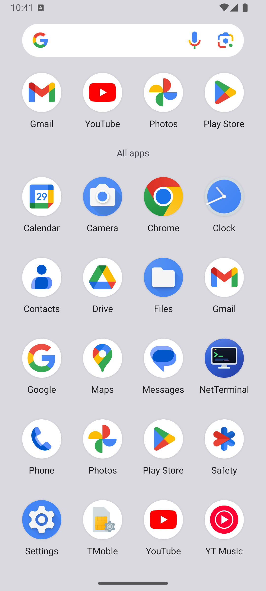
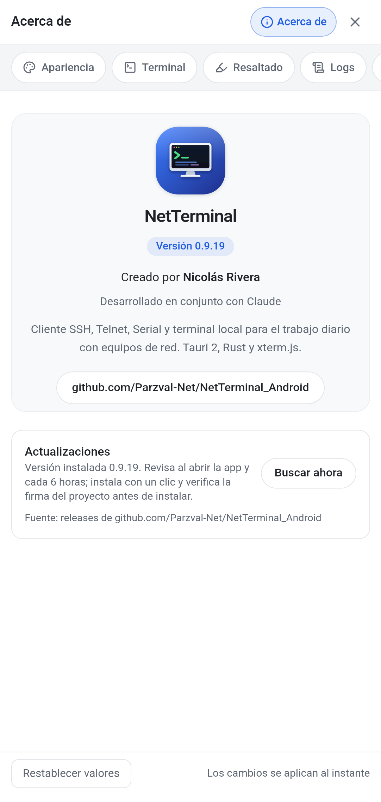
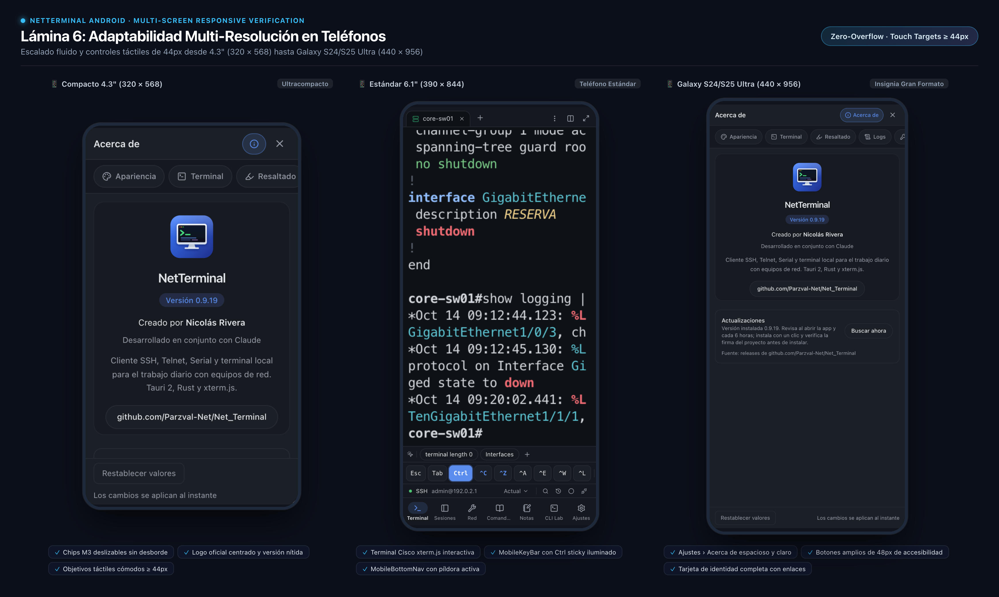

<p align="center">
  
</p>

<h1 align="center">NetTerminal para Android</h1>

<p align="center">
  <b>Cliente móvil de terminal y herramientas de ingeniería de redes para Android</b><br>
  SSH · Telnet · Serial USB-OTG · Shell Local · Catálogo de 2.776 comandos · Bóveda cifrada
</p>

<p align="center">
  <a href="https://github.com/Parzval-Net/NetTerminal_Android/releases/latest"></a>
  <a href="https://github.com/Parzval-Net/NetTerminal_Android/releases/latest"></a>
  <a href="https://github.com/Parzval-Net/NetTerminal_Android/releases/latest"></a>
  <a href="https://tauri.app"></a>
  <a href="https://github.com/Parzval-Net/NetTerminal_Android/releases/latest"></a>
  <a href="LICENSE"></a>
</p>

<p align="center">
  <a href="https://github.com/Parzval-Net/NetTerminal_Android/releases/download/v0.9.19-android/NetTerminal-v0.9.19-android.apk"><b>📲 Descargar APK v0.9.19 (Instalador Universal)</b></a> ·
  <a href="https://github.com/Parzval-Net/NetTerminal_Android/releases/latest">Todas las descargas</a> ·
  <a href="ANDROID.md">Guía de Compilación</a> ·
  <a href="https://github.com/Parzval-Net/Net_Terminal">Edición de Escritorio</a>
</p>

---

## 📱 ¿Qué es NetTerminal Android?

**NetTerminal Android** es el port móvil oficial y de código abierto de [NetTerminal](https://github.com/Parzval-Net/Net_Terminal), diseñado específicamente para **ingenieros de redes, administradores de infraestructura, técnicos de telecomunicaciones y soporte de campo** que necesitan conectarse directamente a routers, switches, firewalls y servidores desde su teléfono o tablet.

Construido sobre un núcleo nativo en **Rust y Tauri 2 Mobile**, NetTerminal Android no es una aplicación web empaquetada ni un cliente Electron pesado: es un binario nativo optimizado que pesa solo **12.6 MB**, arranca en menos de **900 ms** y mantiene un consumo de batería prácticamente nulo en reposo.

---

## 📸 Galería Visual en Android

<div align="center">

| Pantalla de Inicio (Modo Claro) | Modo Oscuro OLED (Material 3) | Shell Linux Local con MobileKeyBar |
| :---: | :---: | :---: |
|  |  |  |
| *Accesos rápidos simétricos de un toque y utilidades de terreno* | *Alto contraste Material You optimizado para pantallas OLED* | *Shell local PTY con teclas de red: Esc, Tab, Ctrl, ^C, ^Z, \|* |

| Ajustes y CLI Lab Modular | Herramientas de Subredes | Catálogo de Comandos Verificados |
| :---: | :---: | :---: |
|  |  |  |
| *Módulos personalizables; CLI Lab activable para tablets* | *Calculadora IPv4/IPv6, Ping, TFTP y Syslog listener* | *2.776 comandos por fabricante con botones táctiles grandes* |

| Ícono Adaptativo Squircle | Diálogo Acerca de Oficial | Adaptabilidad Multi-Pantalla |
| :---: | :---: | :---: |
|  |  |  |
| *Diseño squircle moderno integrado en el dock de Android* | *Licencias, versión y accesos a soporte de la app* | *Validado desde pantallas compactas de 4.3" hasta Tablets* |

</div>

---

## ⚡ Características Principales

### 1. Terminal Multi-Protocolo de Campo
- **SSH & Telnet:** Conexión inmediata a switches, routers y firewalls, compatible con algoritmos criptográficos modernos y perfiles legacy para equipamiento antiguo.
- **Serial USB-OTG:** Conexión por cable de consola directamente al puerto USB-C de tu teléfono usando adaptadores USB-OTG y chips comunes (FTDI, CP210x, CH340, PL2303).
- **Terminal Local PTY (`/bin/sh`):** Acceso al entorno shell nativo del sandbox de Android para pruebas de red locales, diagnósticos de conectividad y utilidades Linux.

### 2. MobileKeyBar: Barra de Teclas Especiales de Red
Los teclados virtuales de Android carecen de teclas indispensables para la línea de comandos de red. NetTerminal incluye una barra flotante siempre accesible:
- `Esc`: Cancelación rápida de comandos interactivos y modos de edición.
- `Tab`: Autocompletado nativo en consolas Cisco IOS, NX-OS, Huawei VRP, Juniper Junos, ArubaOS y FortiOS.
- `Ctrl`: Botón adhesivo táctil para combinaciones críticas (`Ctrl+C` interrupción, `Ctrl+Z` salir a modo privilegiado, `Ctrl+Shift+6` abortar ping en Cisco).
- `|` (Pipe): Inserción inmediata para filtrado (`| include`, `| section`, `| begin`, `| match`).
- `?`: Ayuda contextual inmediata sin alternar capas del teclado.
- `↑` `↓` `←` `→`: Desplazamiento por el historial y cursor de línea.
- **Ajuste dinámico del teclado:** Configurado con `adjustResize` en Android para que el teclado virtual nunca oculte el prompt ni la salida de la terminal.

### 3. Catálogo de 2.776 Comandos Verificados
- Comandos oficiales estructurados para **Cisco (IOS, IOS-XE, NX-OS, IOS-XR), Juniper, Fortinet (FortiGate, FortiSwitch, FortiAP), Huawei, Aruba (AOS-CX, AOS-S, Instant), Check Point, WatchGuard, Grandstream, Linux y Windows**.
- Clasificación visual por nivel de riesgo (**Consulta, Configuración, Crítico**) con confirmación preventiva antes de enviar comandos de alteración de servicio.
- Botones táctiles grandes optimizados para dedos: **Ejecutar**, **Escribir en terminal** o **Copiar al portapapeles**.

### 4. Herramientas de Red Integradas
- **Calculadora de Subredes IPv4 e IPv6:** Máscara de red, wildcard, broadcast, rango de hosts utilizables y notación CIDR.
- **Diagnóstico Activo:** Ping continuo y Traceroute con métricas de RTT y pérdida de paquetes.
- **Servidores de Terreno:** Servidores integrados de TFTP, FTP y Syslog listener en puertos de usuario (>1024) para rescatar configuraciones, subir imágenes y recibir alertas en terreno.
- **Visualizador de Topología:** Consulta de vecinos CDP/LLDP y diagramas de conectividad física.

### 5. Bóveda Cifrada de Credenciales
- Almacenamiento seguro de contraseñas de acceso y llaves privadas cifradas con **Argon2id + XChaCha20-Poly1305**.
- Alojada en el almacenamiento privado seguro del sandbox de Android (`/data/data/cl.netterminal.app/files`), inaccesible para otras aplicaciones del sistema.

### 6. CLI Lab Modular (Ideal para Tablets con Teclado)
- **Modo Móvil Ergonómico (Por Defecto):** En smartphones, CLI Lab viene desactivado por defecto, ofreciendo una barra inferior ultralimpia de 6 botones al alcance del pulgar (*Terminal, Sesiones, Red, Comandos, Notas, Ajustes*).
- **Modo Tablet con Teclado Físico:** Si utilizas una tablet Android con funda-teclado o teclado Bluetooth, puedes activar el módulo con un solo toque desde **Ajustes › Módulos**. Permite enviar procedimientos por lotes línea a línea con detención automática ante errores.

---

## ⚠️ Limitaciones Técnicas del Entorno Móvil

A diferencia de la versión de escritorio para macOS, Windows o Linux, el entorno móvil de Android impone restricciones por seguridad, permisos (SELinux) y gestión de batería:

| Característica Desktop | Estado en Android | Razón Técnica y Alternativa |
| :--- | :---: | :--- |
| **Servidor AI MCP Local** | ❌ Deshabilitado | En móviles no se ejecuta el daemon de servidor MCP por la arquitectura de sockets Unix desktop y para evitar drenaje continuo de batería en segundo plano. |
| **Scripts en Python3 (`.py`)** | ❌ Deshabilitado | Android no incluye el intérprete Python3 en su sistema base. La automatización móvil se realiza mediante el motor nativo de plantillas en Rust con variables `{{variable}}`. |
| **Explorador de Carpetas Libre** | ⚠️ Adaptado (SAF) | Por las políticas de Scoped Storage de Android 11+, la app no puede explorar rutas arbitrarias del sistema de archivos. La exportación e importación de backups y logs se realiza mediante el **Storage Access Framework (SAF)** oficial. |
| **Puertos Privilegiados (<1024)** | ⚠️ Puertos > 1024 | En dispositivos sin root, el kernel de Android prohíbe abrir sockets en puertos reservados. Los servicios escuchan en puertos no privilegiados: **TFTP en 6969**, **FTP en 8021** y **Syslog en 5140**. |
| **Conexiones en Segundo Plano** | ⚠️ Con Doze Mode | El gestor de energía de Android suspende sockets de red si la pantalla se apaga o la app pasa a segundo plano prolongado. Para transferencias críticas de firmware por TFTP/FTP, se recomienda mantener la pantalla encendida. |
| **Pestañas Verticales y Clic Derecho** | ❌ Retirado | Reemplazado por navegación inferior y gestos táctiles nativos más ergonómicos. |

---

## 📊 Métricas de Rendimiento en Android

Mediciones realizadas en hardware y emulador Android 16 (API 36 / ARM64):

| Métrica | NetTerminal Android | Clientes Electron Tradicionales |
| :--- | :---: | :---: |
| **Tamaño del APK Universal** | **12.6 MB** | 85 MB – 120 MB |
| **Tiempo de Arranque en Frío (Cold Start)** | **851 ms** | 2.8 s – 4.5 s |
| **Consumo de Memoria RAM (En reposo / 1 sesión)** | **~154 MB** | 350 MB – 600 MB |
| **Consumo de CPU en segundo plano** | **0.0%** | 1.5% – 4.0% |
| **Permisos Requeridos** | Solo Red (`INTERNET`, `WIFI_STATE`) | Almacenamiento total, ubicación, cámara |

---

## 📥 Instalación

### Requisitos
- Dispositivo Android con **Android 8.0 (Oreo, API 26)** o superior.
- Smartphone, tablet, emulador o terminal móvil rugerizado de terreno.

### Pasos de Instalación
1. Descarga el paquete universal [**NetTerminal-v0.9.19-android.apk**](https://github.com/Parzval-Net/NetTerminal_Android/releases/download/v0.9.19-android/NetTerminal-v0.9.19-android.apk).
2. Abre el archivo descargado desde las notificaciones o desde tu explorador de archivos.
3. Si Android lo solicita, activa la casilla **"Permitir desde esta fuente"** (Instalar aplicaciones desconocidas).
4. Pulsa **Instalar** y ¡listo para conectarte en terreno!

---

## 🛠️ Compilación y Desarrollo

Puedes compilar tus propios APKs de forma gratuita mediante GitHub Actions o en tu máquina local:

```bash
# Compilación local con Tauri 2 CLI
cargo tauri android build --apk
```

Para una guía completa paso a paso con configuración de NDK, firmas de producción con keystore y workflows automatizados en la nube, consulta el documento técnico [**ANDROID.md**](ANDROID.md).

---

## 📄 Licencia y Créditos

- **Licencia:** Distribuido bajo la [Licencia MIT](LICENSE).
- **Autor y Desarrollador:** Nicolás Rivera ([@Parzval-Net](https://github.com/Parzval-Net)).
- **Núcleo Tecnológico:** Desarrollado con [Tauri 2 Mobile](https://tauri.app), [Rust](https://www.rust-lang.org) y [xterm.js](https://xtermjs.org).
