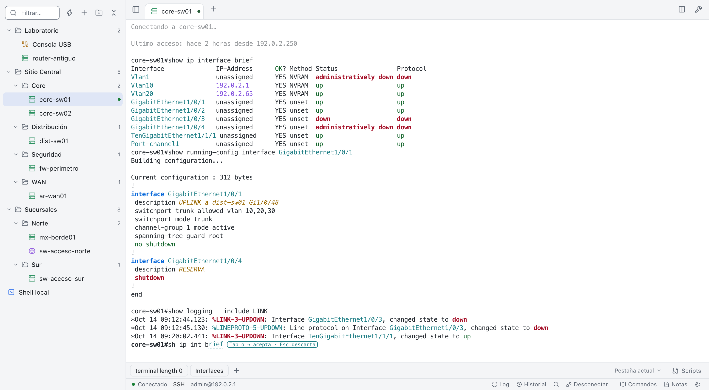

  

<h1 align="center">NetTerminal</h1>

  <a href="https://github.com/Parzval-Net/Net_Terminal/releases/latest"><b>Descargar la última versión</b></a> ·
  <a href="https://parzval-net.github.io/Net_Terminal/">Página del producto</a> ·
  <a href="https://parzval-net.github.io/Net_Terminal/#como-usar">Tutoriales en video</a>

NetTerminal es un cliente de conexión liviano para el trabajo diario con equipos de red y servidores. Reúne **SSH, Telnet, Serial y terminal local** en una sola app, con sesiones guardadas en carpetas y pestañas, un catálogo de comandos verificados por fabricante y las herramientas de red que se usan en terreno y en la oficina. Está pensada para ingenieros y técnicos de redes que necesitan conectarse rápido, ejecutar comandos con seguridad y no perder tiempo configurando. Funciona en macOS, Windows y Linux, pesa unos 8 MB y no consume CPU cuando no la estás usando.

## Descargas

Todos los archivos están en la [última versión publicada](https://github.com/Parzval-Net/Net_Terminal/releases/latest).

| Sistema | Archivo | Comentario |
| --- | --- | --- |
| Windows 10/11 | Instalador `-setup.exe` | Se instala solo para tu usuario, sin permisos de administrador |
| macOS (Intel y Apple Silicon) | `.dmg` universal | La primera vez ábrela con clic derecho › Abrir |
| Linux | `.AppImage` o `.deb` | AppImage sin instalar (`chmod +x` y ejecutar); `.deb` se instala con apt |
| Portable (los 3 sistemas) | `NetTerminal-portable.zip` | Una carpeta con los tres ejecutables y tus datos, ideal para un pendrive |

- **Actualizaciones automáticas:** la app avisa cuando hay una versión nueva y se actualiza con un clic desde Ajustes › Acerca de, siempre con tu confirmación y verificando la firma del proyecto.
- **Modo portable:** si junto al ejecutable hay un archivo llamado `portable`, todo se guarda en la carpeta `data` de al lado. En portable y en `.deb` la actualización es manual.

**Requisitos por sistema**

- **Windows:** WebView2, que ya viene en Windows 11 y en Windows 10 actualizado. Si falta, el instalador lo descarga.
- **macOS:** la app no tiene firma de Apple, por eso la primera vez se abre con clic derecho › Abrir.
- **Linux:** para usar el puerto serial tu usuario debe estar en el grupo `dialout` (o `uucp`). Agregarlo requiere administrador una sola vez.

## Qué puedes hacer

- **Sesiones y conexión rápida:** organiza tus equipos en carpetas, impórtalos desde PuTTY, SecureCRT, MobaXterm, ssh_config o CSV, expórtalos a XML (compatible con SecureCRT) eligiendo cuáles, o conéctate al vuelo sin guardar nada.
- **Catálogo de 2.776 comandos verificados** con fuente oficial para Cisco, Juniper, Fortinet (FortiGate, FortiSwitch, FortiAP y FortiExtender), Huawei, Aruba (AOS-CX, ArubaOS-Switch, ArubaOS 8, AOS 10 e Instant), Check Point, WatchGuard, Grandstream, Windows, macOS y Linux, con la sintaxis de tu plataforma y el nivel de riesgo de cada comando.
- **Sugerencias de comandos** en color mientras escribes, también si abrevias (`sh ip int br`). Tab o → acepta y Esc descarta; sin sugerencia visible, Tab sigue siendo el autocompletado del equipo. Nunca envían Enter y se apagan en modo configuración.
- **Ciclo de vida del equipo** (opcional) en la barra de estado: modelo, versión y etapa EoL (fin de venta, de software y de soporte) según los boletines oficiales, sin enviar comandos.
- **Topología** de vecinos CDP/LLDP con estado de puertos, búsqueda y filtros, revisiones de enlaces (dúplex, VLAN nativa, Port-channel, CRC, asimetrías), ruta entre dos equipos, comparación antes y después de un cambio y exportación a draw.io con íconos de red.
- **Transferencias** de firmware y configuraciones por TFTP, HTTP, FTP y SFTP, con verificación MD5.
- **SNMP** v1, v2c y v3 de solo lectura, receptor de traps y generador de configuración para seis plataformas.
- **Notas, plantillas y envío a varias sesiones:** guarda tus procedimientos con variables como `{{vlan}}` y envíalos a uno o varios equipos, con confirmación según el riesgo.
- **CLI Lab:** arma un script de varios comandos y ejecútalo en varias sesiones a la vez, línea a línea, viendo la respuesta de cada equipo y deteniéndose al primer error.
- **Automatización** con scripts Python y plugins, de solo lectura por defecto y con el mismo control de riesgo que el resto de la app.
- **Contraseñas guardadas en una bóveda cifrada**, que nunca se muestran y se escriben solas al conectar.
- **Temas claro y oscuro**, más 17 temas de terminal, pestañas horizontales o verticales y vista dividida de hasta 4 equipos.

También incluye monitoreo con alarma, ping y traceroute, respaldos y comparación de configuraciones, alertas por palabra clave, logs, calculadora de subredes y speedtest.

## Así se ve

| | |
| --- | --- |
| **Sesiones en carpetas y catálogo de comandos**  | **Sugerencias mientras escribes**  |
| **Topología con ruta resaltada**  | **Vista dividida para varios equipos**  |
| **Notas y plantillas con variables**  | **Modo oscuro**  |

Las capturas usan datos ficticios. Hay más en la [página del producto](https://parzval-net.github.io/Net_Terminal/) y en la [documentación técnica](docs/TECNICO.md#capturas).

## Aprende a usarla

- **Tutoriales en video:** [Tutorial completo (13:32)](https://parzval-net.github.io/Net_Terminal/#como-usar) y [Scripts y plugins (9:25)](https://parzval-net.github.io/Net_Terminal/#como-usar).
- **Ficha del producto:** [página](https://parzval-net.github.io/Net_Terminal/) y [PDF para compartir](docs/NetTerminal-ficha.pdf).
- **Ejemplos listos para usar:** scripts, plugins, packs de comandos y plantillas en [docs/ejemplos](docs/ejemplos/README.md).

## Primeros pasos

1. **Instala** el archivo de tu sistema desde [Descargas](#descargas) o descomprime el zip portable.
2. **Conéctate** desde la búsqueda (⌘K o Ctrl+Shift+K) escribiendo `admin@192.0.2.1` o solo la IP. Para Serial o TCP crudo usa el formulario de Conexión rápida (⌘O o Ctrl+Shift+O), que no guarda la sesión.
3. **Guarda tus equipos** con el **+** de la barra lateral, o impórtalos desde tu cliente actual. Si quieres, guarda la contraseña en la bóveda.
4. **Trabaja con el catálogo** (⌘L o Ctrl+Shift+L): pulsa "Detectar" para ajustar la sintaxis a tu equipo y elige el comando.
5. **Abre las herramientas** (⌘E o Ctrl+Shift+E, o el ícono de la llave en la barra izquierda) para topología, transferencias, SNMP, monitoreo y más; con el mismo atajo vuelves a la terminal sin cerrarlas. Cada módulo se activa en Ajustes › Módulos.

## Atajos principales

| Acción | macOS | Windows / Linux |
| --- | --- | --- |
| Buscar sesión o conexión rápida | ⌘K | Ctrl+Shift+K |
| Conexión rápida sin guardar | ⌘O | Ctrl+Shift+O |
| Nueva sesión | ⌘N | Ctrl+Shift+N |
| Catálogo de comandos | ⌘L | Ctrl+Shift+L |
| Notas | ⌘J | Ctrl+Shift+J |
| CLI Lab | ⌘I | Ctrl+Shift+I |
| Herramientas | ⌘E | Ctrl+Shift+E |
| Buscar en la salida | ⌘F | Ctrl+Shift+F |
| Modo foco (solo pestañas y terminal) | ⌘⇧M | Ctrl+Shift+M |
| Historial de comandos enviados | ⌘Y | Ctrl+Shift+Y |
| Copiar / pegar | ⌘C / ⌘V | Ctrl+Shift+C / Ctrl+Shift+V |

En Windows y Linux los atajos usan Ctrl+Shift para no interferir con Ctrl+C o Ctrl+W dentro de la terminal. La lista completa está en la [documentación técnica](docs/TECNICO.md#atajos).

## Preguntas frecuentes

**¿Necesito permisos de administrador?**
No. El instalador de Windows, el `.dmg`, el AppImage y el zip portable funcionan sin administrador. Solo el `.deb` los requiere. En equipos corporativos con AppLocker o Intune, una app sin firma puede quedar bloqueada: consulta con tu área de TI.

**¿Dónde quedan mis sesiones y notas?**
En la carpeta de configuración de tu usuario o, en modo portable, en la carpeta `data` junto al ejecutable.

**¿Puedo traer mis sesiones de otro cliente?**
Sí. Importa desde PuTTY, SecureCRT, MobaXterm, ssh_config o CSV, con vista previa. Las contraseñas nunca se importan.

**Un equipo antiguo no me deja entrar por SSH. ¿Qué hago?**
Activa los algoritmos legacy en la sesión. Son algoritmos débiles: úsalos solo en redes de gestión confiables.

**Retroceso no borra en un equipo (por ejemplo, Huawei). ¿Qué hago?**
En la sesión, Opciones de terminal › "Retroceso envía", elige BS (^H). Con la plataforma Huawei detectada se usa BS automáticamente. Para probar sin cambiar nada, Shift+Retroceso envía el otro código. Detalle en [Tecla Retroceso](docs/TECNICO.md#tecla-retroceso).

## Seguridad

- **Contraseñas cifradas** en una bóveda que nunca las muestra; solo se escriben en el equipo de destino, nunca en el bastión.
- **Control de riesgo por comando:** lo que cambia configuración se confirma y lo que puede cortar servicio pide confirmación siempre, también desde scripts y plugins.
- **Envío a varias sesiones** con la lista de equipos a la vista y confirmación escribiendo la cantidad de equipos.
- **Secretos enmascarados** en logs y respaldos, y datos con permisos solo para tu usuario en macOS y Linux.
- **Actualizaciones firmadas:** la app verifica la firma antes de instalar y nunca instala sin preguntarte.
- **Servidores y funciones sensibles apagados por defecto** (TFTP, FTP, SNMP traps, agentes IA, algoritmos SSH legacy) hasta que tú los activas.

El detalle de cada control está en la [documentación técnica](docs/TECNICO.md#seguridad) y la política de seguridad, con las limitaciones conocidas, en [SECURITY.md](SECURITY.md).

## Más información

- [Documentación técnica](docs/TECNICO.md): funciones completas, atajos, modo portable, packs de comandos, topología, API de scripts, plugins, publicación y desarrollo.
- [Formato de packs de comandos](docs/TECNICO.md#packs-de-comandos) y [API de scripts Python](docs/TECNICO.md#scripts-python).
- [Ejemplos](docs/ejemplos/README.md) de scripts, plugins, packs y plantillas.
- **¿Encontraste un problema?** Abre un [issue](https://github.com/Parzval-Net/Net_Terminal/issues) con la versión, el sistema operativo y los pasos para reproducirlo. No incluyas contraseñas, IPs ni configuraciones reales.
- **¿Encontraste una vulnerabilidad?** No abras un issue público: repórtala en privado como indica [SECURITY.md](SECURITY.md#cómo-reportar-una-vulnerabilidad).

## Créditos

Creado por Nicolás Rivera · Desarrollado en conjunto con Claude.

Construido con [Tauri 2](https://tauri.app), Rust y xterm.js.
