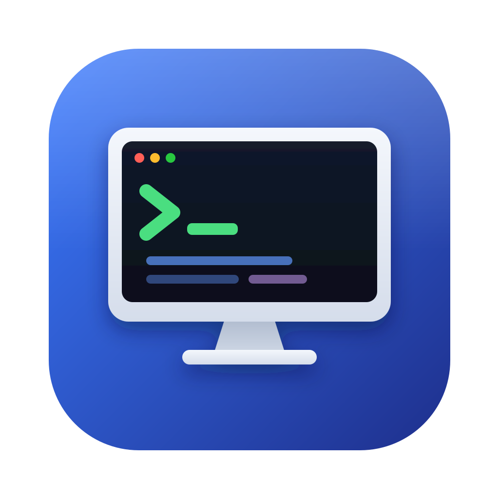
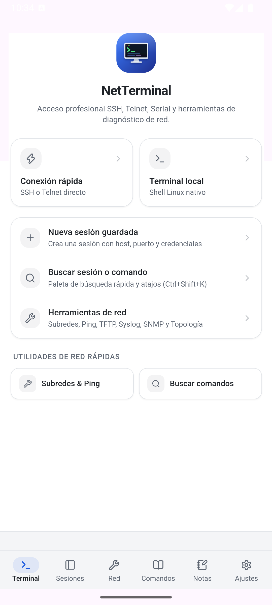
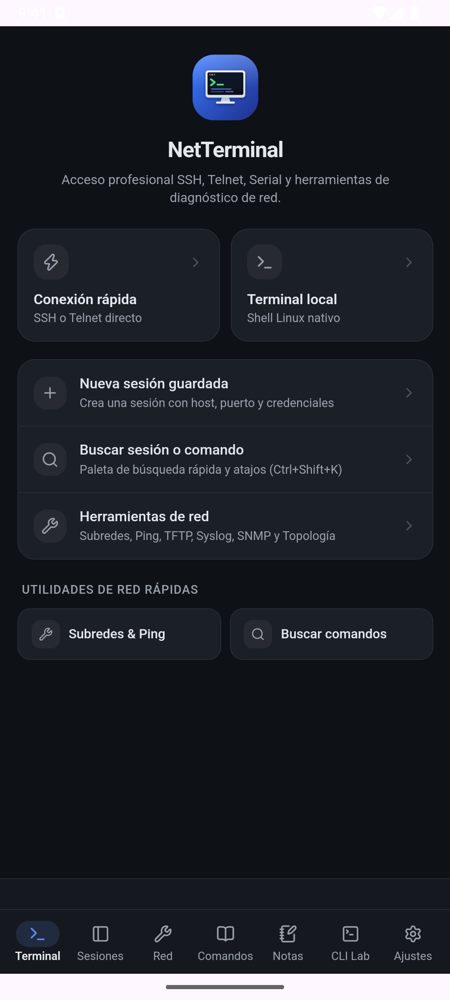
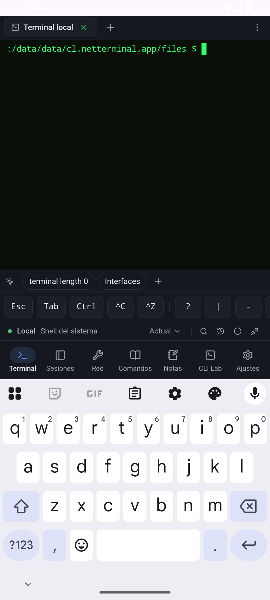
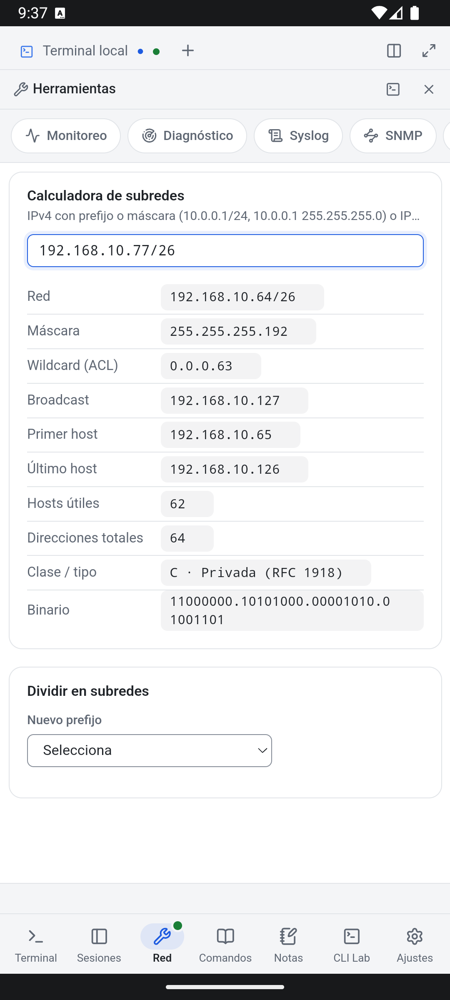
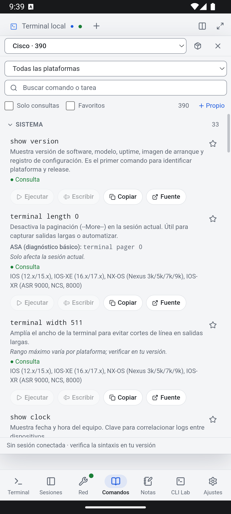
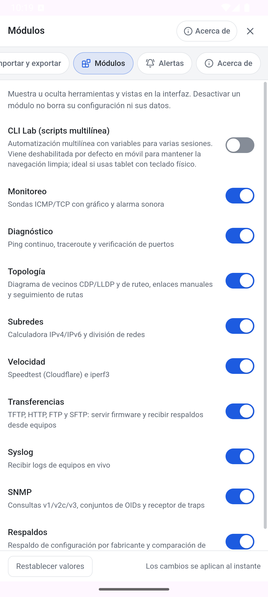

  

<h1 align="center">NetTerminal para Android</h1>

  <b>Terminal y herramientas de redes para smartphones y tablets Android</b> 
  SSH · Telnet · Serial USB-OTG · Terminal local · Diagnóstico · Catálogo de comandos

  
  
  

---

## Qué es

NetTerminal es una terminal de bolsillo para ingenieros de redes, técnicos de telecomunicaciones y soporte de campo. Permite conectarse a routers, switches, firewalls y servidores desde el teléfono o la tablet, incluso por cable de consola, con herramientas de diagnóstico y un catálogo de comandos por fabricante.

Funciona en Android 8.0 o superior, en smartphones y tablets.

| Inicio | Modo oscuro | Terminal con barra de teclas |
| :---: | :---: | :---: |
|  |  |  |

| Subredes | Catálogo de comandos | Módulos |
| :---: | :---: | :---: |
|  |  |  |

---

## Herramientas

### Terminal
- **SSH y Telnet** hacia equipos de red y servidores, con soporte para equipos antiguos (algoritmos legacy).
- **Consola serie por USB-OTG** con adaptadores FTDI, CP210x, CH340 y PL2303.
- **Terminal local** para pruebas de red desde el propio equipo.
- **Barra de teclas de red**: Esc, Tab, Ctrl, `|`, `?` y flechas, sin cambiar de teclado.
- **Sesiones guardadas** en carpetas y **conexión rápida**.

### Diagnóstico de red
- **Ping continuo** con latencia y pérdida, y **traceroute**.
- **Calculadora de subredes** IPv4 e IPv6.
- **Topología** de vecinos CDP / LLDP.

### Operación en terreno
- **Servidores TFTP, FTP y HTTP** para respaldar configuraciones y subir firmware.
- **Syslog** para recibir los logs de los equipos.
- **SNMP v1, v2c y v3** para consultar interfaces y estado.

### Productividad
- **Catálogo de comandos** de Cisco, Juniper, Fortinet, Huawei, Aruba, Check Point, WatchGuard, Grandstream, Linux y Windows, clasificados por riesgo (consulta, configuración, crítico) con confirmación antes de los críticos.
- **Notas** por sitio o equipo.
- **Bóveda cifrada** de credenciales.
- **CLI Lab** para tablets con teclado: envía procedimientos línea a línea y se detiene ante errores.

---

## Alcance

| Herramienta | Smartphone | Tablet |
| :--- | :---: | :---: |
| Terminal SSH / Telnet / Serial / local | ✅ | ✅ |
| Diagnóstico, subredes y topología | ✅ | ✅ |
| TFTP, FTP, HTTP, Syslog y SNMP | ✅ | ✅ |
| Catálogo, notas y bóveda | ✅ | ✅ |
| CLI Lab | Opcional | ✅ |

**Opcional:** se activa en Ajustes › Módulos.

### Fuera de alcance en Android
- **Agentes de IA (MCP) y scripts Python**: disponibles solo en la edición de escritorio.
- **Puertos**: los servicios usan puertos sobre 1024 (TFTP 6969, FTP 8021, Syslog 5140).
- **Segundo plano**: Android puede suspender las conexiones con la pantalla apagada. Para transferencias de firmware, mantener la app abierta.

---

## Descarga

APK en [Releases](https://github.com/Parzval-Net/NetTerminal_Android/releases/latest). Si Android lo pide, habilita "Instalar aplicaciones desconocidas" para el navegador o el explorador de archivos.

Otras ediciones: [iOS](https://github.com/Parzval-Net/Net_Terminal_IOS) · [Escritorio](https://github.com/Parzval-Net/Net_Terminal)

---

## Licencia

[PolyForm Noncommercial 1.0.0](LICENSE.md). Se permite el uso no comercial (personal, educativo, investigación, organizaciones sin fines de lucro y entidades públicas). Cualquier uso comercial, incluido el uso interno en empresas, requiere una licencia aparte del autor. Las versiones publicadas antes del 31-10-2026 conservan los términos con que se distribuyeron.

© 2026 Nicolás Rivera ([@Parzval-Net](https://github.com/Parzval-Net))
