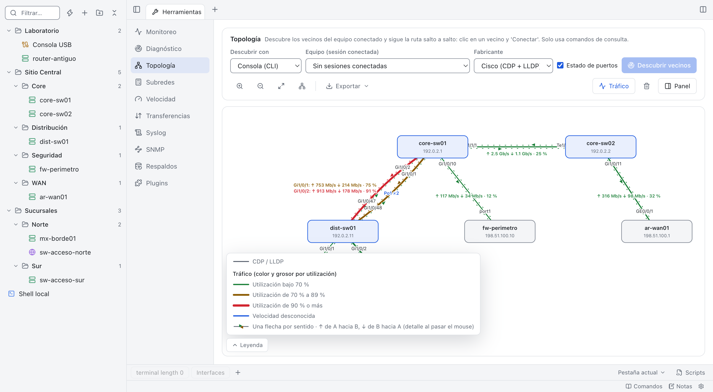
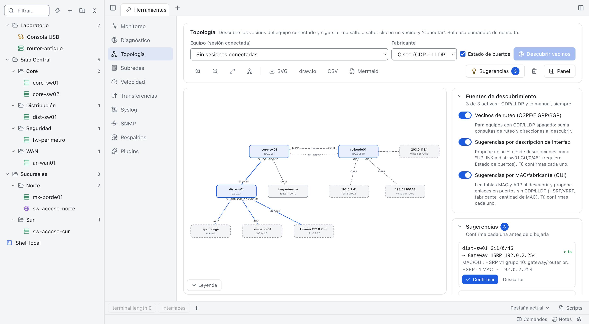
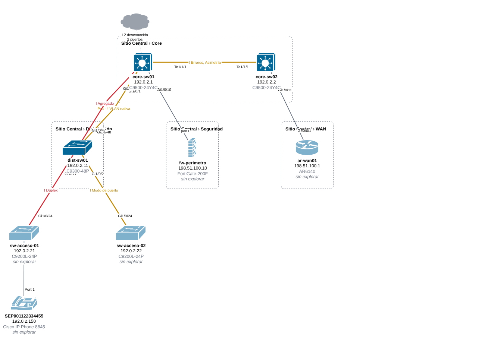
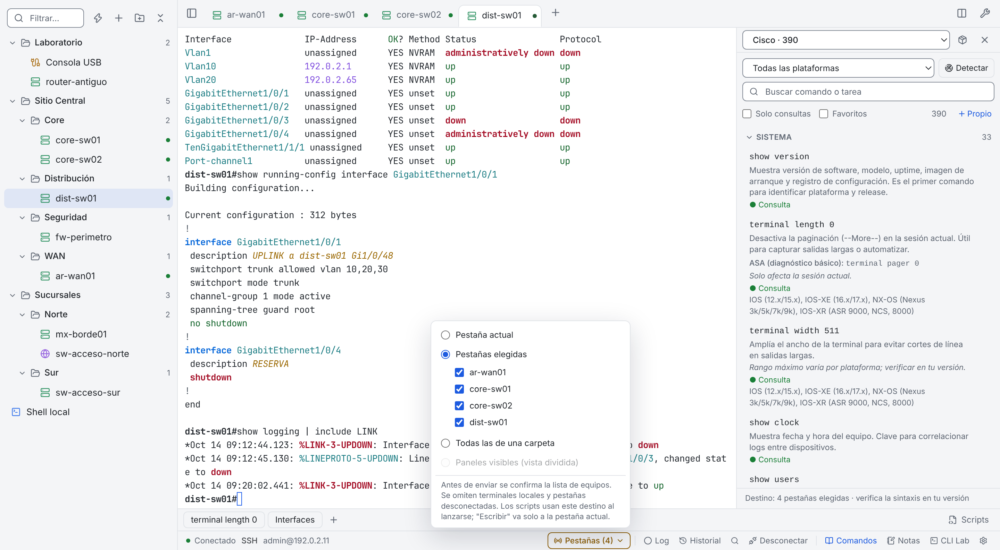
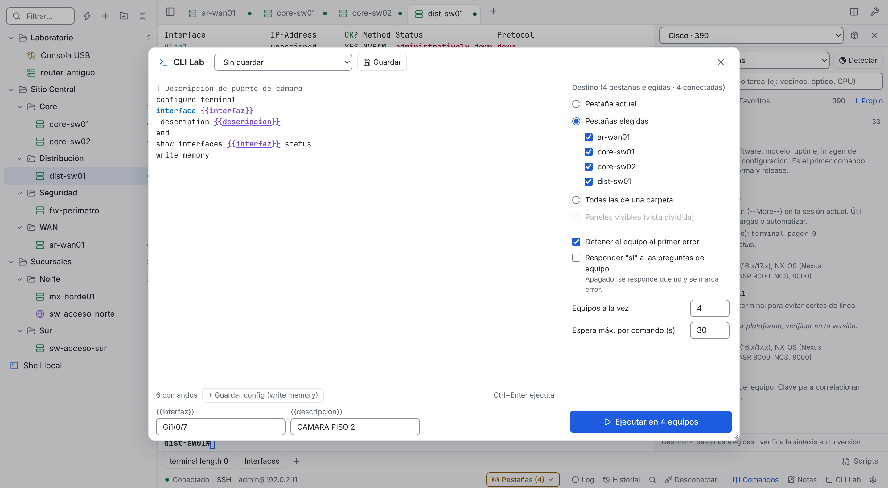
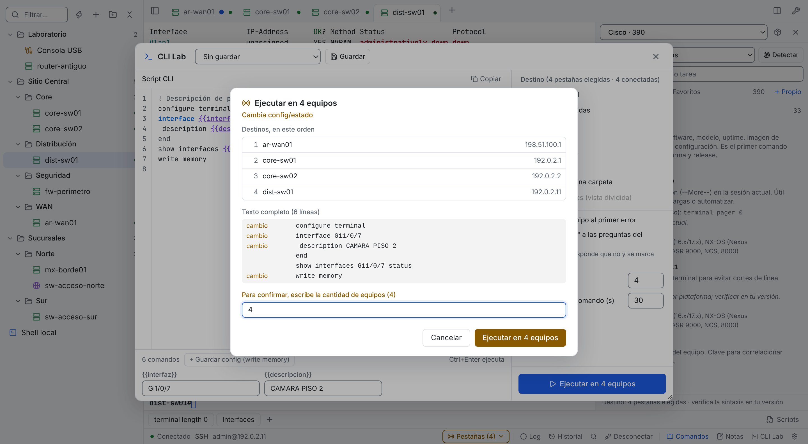
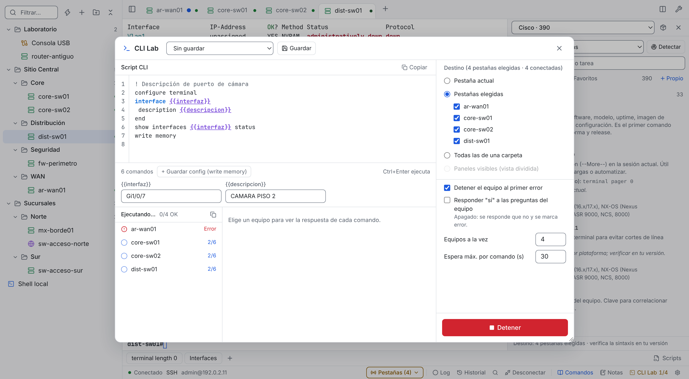
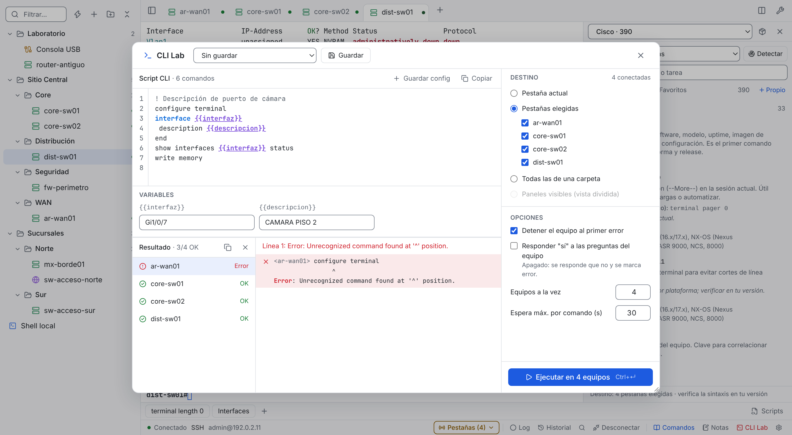
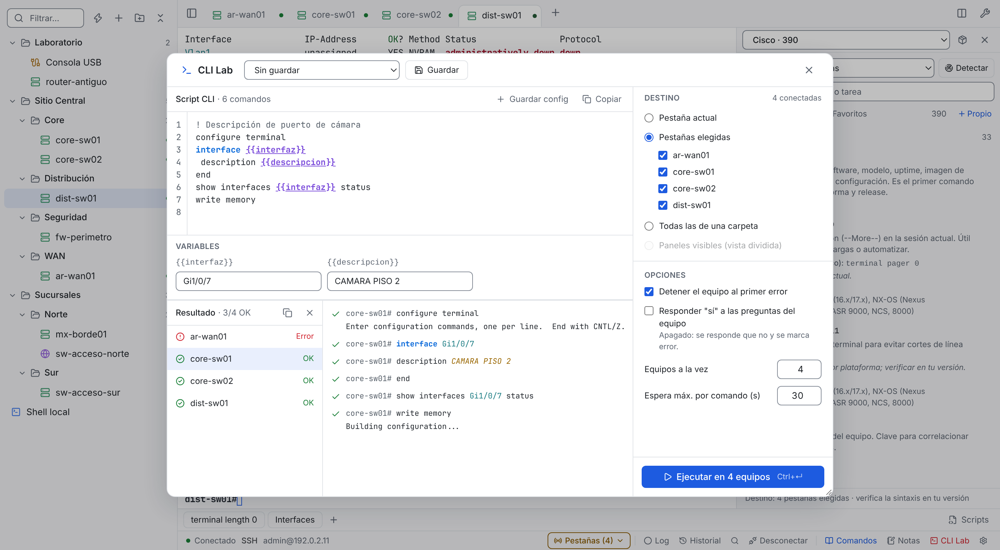

# Documentación técnica

Detalle técnico de NetTerminal: funciones completas, seguridad, formatos, API de scripts, publicación y desarrollo. La presentación general, las descargas y los primeros pasos están en el [README](../README.md).

## Contenido

- [Arquitectura y consumo](#arquitectura-y-consumo)
- [Capturas](#capturas)
- [Funciones](#funciones)
- [Atajos](#atajos)
- [Resaltado de sintaxis](#resaltado-de-sintaxis)
- [Modo portable multisistema](#modo-portable-multisistema)
- [Modo portable (detalle)](#modo-portable-detalle)
- [Ejecutar sin permisos de administrador](#ejecutar-sin-permisos-de-administrador)
- [Seguridad](#seguridad)
- [Packs de comandos](#packs-de-comandos)
- [Topología CDP / LLDP, ruteo y manual](#topología-cdp--lldp-ruteo-y-manual)
- [CLI Lab](#cli-lab)
- [API local para otras aplicaciones](#api-local-para-otras-aplicaciones)
- [Diagramas en notas (Mermaid)](#diagramas-en-notas-mermaid)
- [Ciclo de vida del equipo (EoL)](#ciclo-de-vida-del-equipo-eol)
- [Scripts Python](#scripts-python)
- [Crear un plugin](#crear-un-plugin)
- [Publicar una versión](#publicar-una-versión)
  - [Actualización con un clic](#actualización-con-un-clic)
- [Desarrollo](#desarrollo)
  - [Regenerar las capturas](#regenerar-las-capturas)
  - [Videos tutoriales](#videos-tutoriales)
- [Estructura](#estructura)

## Arquitectura y consumo

Cliente de conexión liviano y multiplataforma (macOS, Windows, Linux) para el trabajo diario con equipos de red y servidores: **SSH, Telnet, Serial y terminal local**, con sesiones guardadas en carpetas y pestañas.

Construido con [Tauri 2](https://tauri.app) (backend en Rust) y xterm.js. Usa el WebView del sistema: la app pesa ~8 MB, usa ~90 MB de memoria en reposo (proceso de la app más los del WebView) y 0 % de CPU sin actividad (medido en macOS, v0.9.0).

**Ficha del producto:** [página](https://parzval-net.github.io/Net_Terminal/) · [PDF para compartir](NetTerminal-ficha.pdf) · [Descargar la última versión](https://github.com/Parzval-Net/Net_Terminal/releases/latest)

**Tutoriales en video:** [Tutorial completo (13:32)](https://parzval-net.github.io/Net_Terminal/#como-usar) · [Scripts y plugins (9:25)](https://parzval-net.github.io/Net_Terminal/#como-usar) · [Ejemplos](ejemplos)

## Capturas

> Capturas en modo claro con datos ficticios (IPs de documentación RFC 5737 y nombres genéricos). La app también tiene modo oscuro y 17 temas de terminal.


| | |
| --- | --- |
| **Notas y plantillas** con variables `{{vlan}}` que se envían a la sesión<br> | **Monitoreo** con gráfico de latencia, pérdida y alarma sonora<br> |
| **Topología CDP/LLDP** con ruta resaltada y Port-channel<br> | **Comparación con un snapshot**: enlaces y equipos nuevos o perdidos<br> |
| **Comandos de sistema operativo**: Windows, macOS y Linux por distribución<br> | **Packs de comandos**: 2.776 comandos, ampliables<br> |
| **Modo oscuro**: la interfaz sigue al sistema o se fija en claro u oscuro<br> | **17 temas de terminal** con vista previa (Ámbar, Dracula, Nord, Tokyo Night…)<br> |
| **Pestañas verticales** opcionales, como en Edge o Firefox<br> | **Contraseñas guardadas** en una bóveda cifrada, nunca visibles<br> |
| **Velocidad**: speedtest e iperf3 cliente/servidor<br> | **Vista dividida en modo oscuro**<br> |
| **Vista dividida** 2x2 para seguir varios equipos a la vez<br> | **Respaldos y comparación** de configuraciones con secretos enmascarados<br> |
| **Enviar a varias sesiones** con lista de equipos y control de riesgo<br> | **Alertas por palabra clave** en la salida<br> |
| **Importar sesiones** desde ssh_config, PuTTY, SecureCRT, MobaXterm o CSV<br> | **Calculadora de subredes** IPv4/IPv6 con división en subredes<br> |
| **Cliente SNMP** v1/v2c/v3 con conjuntos de OIDs y receptor de traps<br> | **Generador de configuración SNMP** de solo lectura para 6 plataformas<br> |
| **Transferencias**: TFTP, HTTP, FTP y SFTP con la carpeta compartida<br> | **Conexión rápida** sin guardar la sesión (ícono de rayo)<br> |
| **Notas protegidas** con contraseña y bloqueo por inactividad<br> | **Acerca de** con versión y actualizaciones<br> |

## Funciones

| Área | Detalle |
| --- | --- |
| SSH | Usa el OpenSSH del sistema: respeta `~/.ssh/config`, agente, llaves y `known_hosts`. Jump host (ProxyJump), túneles locales, remotos y dinámicos por sesión (escucha en 127.0.0.1 por defecto) y opción de algoritmos legacy para equipos antiguos. Opcional y apagado por defecto: Ajustes › Terminal › "Activar algoritmos legacy automáticamente" reconecta una vez en modo compatible si el equipo exige ssh-rsa, SHA1 o CBC y lo deja guardado en la sesión. Usa algoritmos débiles: actívalo solo en redes de gestión confiables. |
| Sugerencias de comandos | Encendidas por defecto (Ajustes › Terminal). En sesiones SSH, Telnet, Serial y TCP con la plataforma detectada o fijada en el catálogo, muestra en color el resto de un comando de consulta mientras escribes, también si lo escribes abreviado como en el equipo (`sh ip int br` → `show ip interface brief`, `dis int br` → `display interface brief`; Cisco, Huawei, Junos y FortiOS). Tab o → acepta la sugerencia, Ctrl+→ u Option+→ acepta solo la siguiente palabra, Esc la descarta en esa línea (hasta el próximo Enter) y Ctrl+. abre una lista de hasta 8 comandos (↑↓, Enter inserta, Esc cierra; la tecla se puede cambiar a Alt+/ o Ctrl+Espacio). Primero va el prefijo exacto, luego las abreviaturas, y suben los favoritos y los comandos que aceptaste o ejecutaste antes en esa plataforma (historial local con botón "Borrar historial de sugerencias"); a igual uso gana el que completa con menos palabras y menos texto y sin filtro `|` (`sh run` → `show running-config`). Tab acepta solo si hay una sugerencia visible; sin ella (en un marcador como `{{interfaz}}`, un nombre de interfaz o VRF que no está en el catálogo, o tras Esc) va al equipo y funciona su autocompletado, igual que Esc sin sugerencia. Un segundo Tab dentro de 400 ms tras uno que aceptó también va al equipo, para encadenar su autocompletado. Tras el Tab nativo del equipo o la ayuda `?`, NetTerminal relee la línea de la pantalla (prompt + lo escrito) y las sugerencias siguen en el resto de la línea. Nunca se envía Enter y los comandos con variables se insertan hasta la variable. **Color:** automático por tema (cian del tema, o azul, magenta o ámbar si el cian no sirve), con al menos 3:1 de contraste con el fondo en los 17 temas (WCAG 1.4.11), nunca gris y distinto del texto y del cursor; va con subrayado punteado por defecto para no confundirse con el resaltado de la salida; se puede fijar en Cian, Ámbar, Magenta o Azul y cambiar el estilo a cursiva o solo color (Ajustes › Terminal › Color y Estilo de la sugerencia). **Ayuda:** en las primeras 5 líneas con sugerencia de cada plataforma aparece «Tab o → acepta · Esc descarta» junto a ella (oculta para lectores de pantalla, no toma teclas ni clics); se apaga en Ajustes y vuelve al borrar el historial. Retroceso siempre llega al equipo (DEL o BS). En modo configuración (`(config-if)#`, vista de sistema `[...]` de Huawei, `#` de Junos, bloques `config` de FortiOS) no hay sugerencia en línea, porque ahí una abreviatura puede ser otro comando (`sh` es `shutdown` en una interfaz Cisco); solo vuelve tras `do ` (Cisco), `run ` (Junos) o con `display`/`show` escrito completo (Huawei, ASA). Tampoco aparece si lo tecleado, tal como está, ya puede ser un comando con riesgo (`request system storage cleanup` sin `dry-run`). En Linux con IBus, Ctrl+. puede abrir el selector de emojis: cambia la tecla a Alt+/. Se recupera solo tras un mensaje asíncrono que redibuja la línea o si escribiste antes de que llegara el prompt. Con plataforma desconocida avisa una vez por pestaña cómo detectarla. No funciona en la terminal local.<br> |
| Telnet | Cliente nativo en Rust (negociación ECHO, SGA, tipo de terminal y tamaño de ventana). No requiere `telnet` instalado. |
| TCP crudo | Conexión TCP directa sin negociación Telnet, para servidores de consola (puertos 2001+). |
| Serial | Puertos detectados automáticamente, 1200 a 921600 baudios, 8N1/7E1, control de flujo, envío de Break. |
| Terminal | Pestañas que mantienen la sesión al cambiar, vista dividida (2 o 2x2), reconexión con Enter o automática con espera creciente, búsqueda en la salida, copiar al seleccionar y pegar con clic derecho (con confirmación si son varias líneas), zoom de fuente. |
| Enviar a varias sesiones | Desde Notas, catálogo o botones: pestaña actual, pestañas elegidas, una carpeta o los paneles visibles. Confirma con la lista de equipos y el riesgo de cada línea (los cambios exigen escribir la cantidad de equipos), envía en secuencia y se puede detener. |
| Alertas | Reglas por texto o expresión (globales o por carpeta) que avisan en pantalla, con sonido y marca en la pestaña. Máximo un aviso cada 10 s por regla y sesión; nunca envían comandos. Sin reglas no consumen nada. |
| Respaldos | Respaldo de configuración (solo comandos de consulta, hasta 3 equipos a la vez) en `data/backups`, con secretos enmascarados, y comparación entre fechas o entre equipos. Entre fechas del mismo equipo marca "secreto cambiado" cuando cambia un valor enmascarado: guarda una huella HMAC-SHA256 por secreto con una llave aleatoria del equipo, nunca el secreto. |
| CLI Lab | Editor de scripts multilínea (botón "CLI Lab" de la barra de estado, ⌘I / Ctrl+Shift+I o la paleta), inspirado en el CLI Code Lab de FortiOS 8.0. Ejecuta línea a línea en el destino elegido leyendo cada respuesta, se detiene al primer error de CLI y muestra la salida por equipo. Ver [CLI Lab](#cli-lab). |
| Exportar | Sesiones elegidas (por carpeta, filtro o una a una) a XML con el esquema de SecureCRT, que se abre en SecureCRT y se reimporta en NetTerminal, o a JSON en el portapapeles. Desde Ajustes › Sesiones, el menú de una carpeta o la paleta. Nunca incluye contraseñas ni comandos al conectar. |
| Importar | Sesiones desde `~/.ssh/config`, PuTTY (.reg), SecureCRT (XML), MobaXterm (.mobaconf/.mxtsessions) y CSV (hasta 64 MB), con vista previa. Al reimportar, las sesiones que ya existen en la misma carpeta con el mismo nombre se marcan "Cambia" y se puede elegir sobrescribir sus datos de conexión (se conservan contraseña guardada, comandos al conectar, túneles y resaltado) u omitirlas. Nunca importa contraseñas, comandos al conectar, proxies ni túneles. |
| Conexión rápida | Formulario SSH, Telnet, TCP crudo o Serial sin guardar la sesión, primera opción de la pantalla de inicio, rayo antes del "+" de nueva sesión o ⌘O / Ctrl+Shift+O (ícono de rayo en la pestaña). "Guardar como sesión…" en el menú de la pestaña y en la barra de estado. |
| Historial | Destinos recientes en la conexión rápida (⌘K) y últimos comandos enviados a cada equipo desde Notas, catálogo o botones (nunca lo tecleado). |
| Notas | Panel lateral con notas en `.txt` (autoguardado, resaltado por fabricante), búsqueda en todas las notas y buscar/reemplazar (renombrar, proteger, eliminar y abrir la carpeta van en el menú "…"). Envía la línea, la selección o todo a la sesión activa (con control de riesgo y pausa por línea opcional) y captura texto de la terminal. |
| Paneles laterales | Comandos y Notas comparten un ancho ajustable desde su borde, que se recuerda (por defecto el 30% de la ventana, entre 300 y 380 px). Si la terminal quedaría bajo 560 px (por ejemplo en una pantalla de 1024 px), el panel se superpone a la terminal en vez de achicarla, para que salidas como `show ip interface brief` no se partan. |
| Notas protegidas | Una nota se puede proteger con contraseña: queda cifrada en disco (`.ntenc`, XChaCha20-Poly1305 con llave Argon2id por nota) y se bloquea a mano, por inactividad (5 min por defecto), al cambiar de nota o al cerrar el panel. No aparece en la búsqueda de contenido. |
| Logs | Grabación de la sesión a texto plano (sin códigos de color) en la carpeta `logs` o en una carpeta que elijas (validada, archivos 600): nombre por patrón (`{session}`, `{host}`, `{folder}`, `{date}`, `{time}`), anexar o archivo nuevo, rotación diaria, hora por línea y secretos enmascarados (activado por defecto). El log continúa en el mismo archivo al reconectar. |
| Plantillas | Variables `{{nombre}}` en Notas: al enviar se piden los valores (se recuerdan los últimos, salvo las que parecen contraseñas o claves, que se piden ocultas y no se guardan). |
| Sesiones | Carpetas y subcarpetas ilimitadas, arrastrar y soltar con orden libre (una línea indica si queda antes o después; al soltar sobre el centro de una carpeta entra en ella y una carpeta cerrada se abre sola tras un instante), menú contextual (conectar todas, nueva sesión aquí, renombrar, duplicar, mover al inicio, subir, bajar, mover al final), indicador de sesiones abiertas. Shell local y las carpetas también se reordenan. El orden se guarda en Ajustes (`sidebarOrder`). |
| Contraseñas | Opcional por sesión (SSH, Telnet, TCP y Serial): se guarda en una bóveda cifrada de la app (`credentials.vault`) y se completa sola en el primer pedido de contraseña al conectar; en Telnet/Serial también envía el usuario. Campo solo de escritura (nunca se muestra), llave en el llavero del sistema o contraseña maestra en modo portable (Ajustes › Credenciales). |
| Botones y scripts | Barra de comandos rápidos (texto con `{{variables}}` o script). Scripts Python con API mínima `import netterminal as nt` (`run`, `send`, `wait_for`, `expect`, `read`), similar a `crt.Screen` de SecureCRT, en una o varias sesiones elegidas al lanzarlo, de solo lectura por defecto y con "Detener script". `wait_for(patrón)` devuelve todo lo acumulado desde la última lectura (eco del comando incluido); `expect(patrón)` devuelve solo hasta la coincidencia; al vencer el plazo lanzan `nt.ScriptTimeout`. Incluye ejemplo de respaldo de configuración. El menú Scripts permite "Buscar en el equipo…" (copia el .py elegido a la carpeta de scripts, sin sobrescribir uno distinto con el mismo nombre) y "Eliminar un script…" (lo mueve a `scripts/eliminados`, recuperable). Ver [Scripts Python](#scripts-python). |
| Agentes IA (MCP) | Servidor MCP local para Claude Code, Claude Desktop, Gemini CLI y Codex: listar sesiones, leer salida, ejecutar comandos con aprobación del usuario y modo solo lectura. Apagado por defecto. |
| Topología | Diagrama de vecinos CDP/LLDP (Cisco, Huawei, Juniper, Fortinet) por consola o por SNMP con un perfil v2c/v3 (LLDP-MIB, CISCO-CDP-MIB y, según las fuentes, OSPF-MIB, BGP4-MIB, BRIDGE/Q-BRIDGE-MIB e IP-MIB), vecinos OSPF/EIGRP/BGP opcionales, equipos y enlaces manuales, sugerencias desde descripciones y desde la tabla MAC (HSRP/VRRP y fabricante por OUI), con estado de puertos y Port-channel, tráfico por sentido en cada enlace (opcional, por SNMP o por consola, con color por utilización), ruta entre dos equipos, snapshots para comparar antes y después de un cambio, y exportación a SVG, draw.io, CSV o Mermaid. Si un vecino solo se alcanza desde el equipo y no desde el PC, "Saltar desde" envía en la misma pestaña `ssh -l usuario IP` (NX-OS `ssh usuario@IP`, Huawei `stelnet IP`, Junos `ssh usuario@IP`, FortiOS `execute ssh`, o `telnet`), te autenticas ahí y el descubrimiento sigue en esa pestaña; la ruta de saltos se muestra con "Volver" (`exit`). El fabricante se ajusta solo según el prompt. El tráfico por consola de un equipo alcanzado así se lee por esa pestaña, y se descarta si la pestaña está en otro equipo. |
| Comandos (⌘L) | Catálogo de 2.776 comandos verificados con fuente oficial. Equipos de red: Cisco (IOS, IOS-XE, NX-OS, IOS-XR, ASA), Juniper (Junos, Evolved, EX sin ELS), Fortinet (FortiOS 6.2 a 7.6 con gestión de FortiSwitch, FortiAP y FortiExtender, y la CLI propia de FortiSwitchOS, FortiAP y FortiExtender 4.x a 8.x, incluidos LAN extension y FortiGate con módem LTE/5G integrado), Huawei (VRP5, VRP8 y YunShan OS, en routers AR/NE y switches S, CloudEngine S y CloudEngine DC), Aruba (AOS-CX, ArubaOS-Switch, ArubaOS 8, AOS 10 e Instant), Check Point (R80.40 a R82, clish y expert) WatchGuard (Fireware 12.x y 2025+) y Grandstream (switches GWN78xx; los AP y routers GWN se administran desde GDMS y su CLI es un menú, por eso no tienen catálogo). Cisco Meraki (MS, MR, MX y Catalyst en modo nube) no tiene CLI local para el operador: se administra desde el Dashboard. Sistemas operativos (consultas de red: interfaces, DNS, rutas, ARP, conexiones, tráfico, Wi-Fi, firewall): Windows 10/11/Server (PowerShell), macOS 12 a 27 y Linux (Debian, Ubuntu, RHEL/Rocky/Alma, Fedora, SUSE, Arch, Alpine). Sintaxis por plataforma detectada, nivel de riesgo, favoritos, comandos propios y packs importables. En la terminal local se abre el catálogo del sistema del PC. |
| Opciones por sesión | Comandos al conectar, reconexión automática, Enter como CR/LF/CRLF, Retroceso como DEL o BS (ver [Tecla Retroceso](#tecla-retroceso)), eco local y codificación (UTF-8, Latin-1, Windows-1252). |
| Pestañas | Horizontales (por defecto) o verticales a la izquierda, con ancho ajustable y modo solo íconos. Se reordenan arrastrándolas (Esc cancela). Renombrar, desconectar sin cerrar, copiar toda la salida, limpiar historial, reiniciar terminal e indicador de actividad en segundo plano. Cerrar las demás, las de la derecha (o de abajo) o todas, con un aviso que detalla las sesiones conectadas que se cortan, las transferencias SCP/SFTP que se cancelan y las conexiones rápidas sin guardar que se pierden (los logs ya grabados quedan en disco). |
| Herramientas (⌘E) | Monitoreo ICMP/TCP con gráfico y alarma sonora; ping, traceroute y puertos; topología; calculadora de subredes; speedtest (Cloudflare, respeta el proxy del sistema) e iperf3; respaldos; transferencias (TFTP, HTTP, FTP y SFTP); Syslog; SNMP. Cada módulo se activa en Ajustes › Módulos. Abierta desde el Dock o el Finder en macOS, la app agrega al final del PATH `/opt/homebrew/bin`, `/usr/local/bin` y el Python de python.org (en Linux, `~/.local/bin`), para encontrar iperf3 y Python. iperf3 se busca además fuera del PATH: en Windows el PATH vigente del registro (lo que agregó un instalador con la app abierta), junto a NetTerminal.exe, winget (`WinGet\Links` y `Packages`), Chocolatey, Scoop y carpetas `iperf*` en Descargas, Escritorio, Documentos, la carpeta personal, Archivos de programa y `C:\`; en macOS MacPorts (`/opt/local/bin`); en Linux `/snap/bin` y Homebrew de Linux. Cada candidato se confirma con `--version`. Si está en otra carpeta, "Elegir iperf3…" en Herramientas › Velocidad guarda la ruta (solo un ejecutable llamado iperf3), y "Buscar de nuevo" repite la búsqueda sin reiniciar la app. |
| SNMP | Cliente de consulta v1, v2c y v3 (USM): GET, GETNEXT, WALK acotado y cancelable y GETBULK. Solo lectura, sin SET. v3 con SHA-256 + AES-128 por defecto (RFC 7860 y RFC 3826), AES-192/256 en variantes net-snmp y Cisco, MD5/DES solo como legado. Conjuntos de OIDs (identidad, interfaces con contadores de 64 bits y tasas, almacenamiento, CPU, procesos, carga y memoria) con exportación CSV. Receptor de traps apagado por defecto: v1, v2c, informs confirmados y traps v3 verificados con el usuario del perfil. Community y contraseñas v3 solo en la bóveda cifrada, atadas al host y puerto del perfil. |
| Generador SNMP | Configuración de agente de solo lectura para Cisco IOS/IOS-XE, NX-OS, Huawei VRP, Junos, FortiOS y net-snmp (`snmpd.conf`): v3 authPriv por defecto, ACL por NMS, vista sin subárboles sensibles, traps o informs, interfaz de origen y sysContact/sysLocation. Nunca genera communities RW. Los secretos van como marcadores (`<AUTH_PASS>`) salvo que los escribas, y no se guardan. La sintaxis que depende de la versión del equipo queda marcada en un comentario para verificar. |
| FTP y SFTP | Servidor FTP de la carpeta compartida (usuario nt y contraseña nueva en cada inicio, solo lectura por defecto, subidas que se activan o quitan con el servidor en marcha, sin FTP bounce) y cliente FTP/FTPS explícito (AUTH TLS; el FTPS implícito del puerto 990 no está soportado) con TLS verificado por los certificados del sistema. SFTP con el OpenSSH del sistema: en el gestor de archivos y como pestaña `sftp` interactiva. FTP no cifra: la app lo advierte y sugiere SCP/SFTP o HTTP. |
| Gestor de archivos | Dos paneles PC ↔ equipo sobre la sesión abierta: lista el flash, envía o trae archivos por TFTP/HTTP/FTP y copia la configuración a la carpeta compartida (Cisco, NX-OS, Huawei, Junos; perfil según la plataforma detectada, NX-OS con `bootflash:` y `vrf management`). La app escribe el `copy`, responde las confirmaciones y muestra el progreso. Usa el servidor que ya esté activo o lo inicia y lo detiene al terminar; las subidas que necesita una extracción se habilitan en caliente, sin reiniciar el servidor ni cambiar la contraseña FTP, y se quitan al final. Verificación MD5 automática del firmware enviado por TFTP, HTTP, FTP, SCP o SFTP: con SCP/SFTP la copia corre en otra pestaña y, cuando ese proceso termina con código 0, el gestor corre el mismo comando MD5 en la sesión del equipo; con otro código, o si cierras la pestaña antes, avisa y no verifica. Si un script tiene tomada la sesión del equipo, reintenta cada 5 s hasta 2 minutos sin escribir en ella. En el SFTP interactivo (put/get a mano) no hay un fin claro: al cerrar su pestaña se recuerda pulsar "MD5". Aviso de espacio insuficiente. La copia de configuración queda sin enmascarar y fuera de Respaldos; para historial enmascarado y comparable usa Herramientas › Respaldos. Los comandos para copiar usan la IP elegida (por defecto la de la ruta por defecto, físicas antes que virtuales) y el archivo seleccionado. |
| Plugins | Carpeta con `plugin.json` + script Python. Instalación con revisión de permisos y código; se bloquean si sus archivos cambian. |
| Ajustes | Agrupados en General, Sesiones y datos, Herramientas e Integraciones, con buscador. Actualizaciones y créditos ("Desarrollado en conjunto con Claude") en Acerca de. |
| Actualizaciones | Aviso de versión nueva desde GitHub Releases y botón "Actualizar y reiniciar": descarga, verifica la firma del proyecto e instala. Nunca instala sin confirmación y avisa si hay sesiones abiertas. En modo portable y en `.deb` la actualización sigue siendo manual. |
| Compartir | Exportar/importar sesiones y reglas de resaltado como JSON vía portapapeles. |
| Apariencia | Interfaz en modo sistema, claro u oscuro, con contraste WCAG AA en textos (4,5:1) y controles (3:1). 17 temas de terminal (Ámbar, Fósforo verde, Clásico, Dracula, Nord, Solarized, Gruvbox, One Dark, Tokyo Night, Catppuccin Mocha y Latte, Monokai, GitHub Dark, Rosé Pine, etc.), fuente, tamaño, interlineado y cursor configurables. |
| Resaltado | Coloreo de salida por regex para Cisco/Arista (IOS, IOS-XE, NX-OS, IOS-XR, ASA), Juniper, Huawei/H3C (VRP y Comware), Fortinet (FortiGate, FortiSwitch, FortiAP y FortiExtender), Aruba (AOS-CX, ArubaOS-Switch y ArubaOS), Grandstream (GWN78xx), Check Point (clish, expert y ClusterXL) y reglas comunes (IPv4/IPv6, MAC, up/down, permit/deny, contadores de error > 0, syslog por severidad). Perfil por sesión, reglas propias con vista previa e importación/exportación JSON. |

## Atajos

| Acción | macOS | Windows / Linux |
| --- | --- | --- |
| Ajustes | ⌘, | Ctrl+, |
| Notas | ⌘J | Ctrl+Shift+J |
| CLI Lab | ⌘I | Ctrl+Shift+I |
| Catálogo de comandos | ⌘L | Ctrl+Shift+L |
| Herramientas | ⌘E | Ctrl+Shift+E |
| Duplicar pestaña | ⌘D | Ctrl+Shift+D |
| Enviar línea o selección / todo (en Notas) | ⌘↵ / ⌘⇧↵ | Ctrl+Enter / Ctrl+Shift+Enter |
| Buscar sesión / conexión rápida | ⌘K | Ctrl+Shift+K |
| Nueva sesión | ⌘N | Ctrl+Shift+N |
| Conexión rápida sin guardar | ⌘O | Ctrl+Shift+O |
| Terminal local | ⌘T | Ctrl+Shift+T |
| Cerrar pestaña | ⌘W | Ctrl+Shift+W |
| Cerrar todas las pestañas (con aviso) | ⌘⇧W | Ctrl+Shift+Alt+W |
| Buscar en la salida | ⌘F | Ctrl+Shift+F |
| Mostrar/ocultar sesiones | ⌘B | Ctrl+Shift+B |
| Cambiar de pestaña | Ctrl+Tab · ⌘1…9 | Ctrl+Tab |
| Zoom | ⌘+ ⌘- ⌘0 | Ctrl+Shift++ Ctrl+Shift+- Ctrl+Shift+0 |
| Copiar / pegar | ⌘C / ⌘V | Ctrl+Shift+C / Ctrl+Shift+V |
| Sugerencias: aceptar / una palabra / descartar / abrir la lista | Tab o → / ⌥→ / Esc / Ctrl+. | Tab o → / Ctrl+→ / Esc / Ctrl+. |

En Windows/Linux los atajos usan Ctrl+Shift para no interferir con Ctrl+C, Ctrl+W, etc. dentro de la terminal.

Conexión rápida (⌘K): `ssh admin@192.0.2.1:2222`, `telnet 192.0.2.5 23`, `admin@router` o solo la IP. Para Serial o TCP crudo usa el formulario del rayo en la pantalla de inicio.

### Tecla Retroceso

Opción por sesión "Retroceso envía" (Opciones de terminal de la sesión y Opciones avanzadas de la conexión rápida):

| Valor | Envía | Cuándo |
| --- | --- | --- |
| Automático (por defecto) | BS (0x08, ^H) en plataformas Huawei (`vrp5`, `vrp8`, `yunshan`) o, sin plataforma detectada, cuando la línea empieza con un prompt de Huawei (`<equipo>`, `[equipo]`, `[~equipo]`); DEL (0x7f, ^?) en el resto | Sesiones nuevas y existentes |
| DEL (^?) | 0x7f | Valor de xterm, PuTTY y la mayoría de las terminales |
| BS (^H) | 0x08 | Equipos que solo borran con Ctrl+H |

- Huawei documenta CTRL_H como tecla de sistema que borra el carácter a la izquierda del cursor (no se puede reasignar con `hotkey`, que solo cambia CTRL_G, CTRL_L, CTRL_O y CTRL_U) y no documenta DEL. Por eso el automático usa BS con la plataforma Huawei detectada o fijada y, mientras la plataforma no se conoce (por ejemplo en Conexión rápida), cuando el prompt de la línea es de Huawei. Si aun así Retroceso no borra, elige BS en la sesión.
- Shift+Retroceso envía el otro código (como en PuTTY), para probar sin cambiar la sesión.
- Ctrl+Retroceso y Alt/Option+Retroceso envían ^W (borrar la palabra a la izquierda; VRP CTRL_W, IOS, ASA, Junos, bash y zsh). En pantalla completa (vim, nano) siguen la convención de xterm.
- SSH: con BS, la PTY local de `ssh` usa ^H como carácter de borrado (VERASE). OpenSSH lo informa al servidor al pedir la terminal (RFC 4254, sección 8), igual que PuTTY, y el pedido de contraseña del propio `ssh` también borra con ^H. En Windows (ConPTY) no aplica.
- Telnet y Serial: el byte llega sin cambios (Telnet solo duplica 0xFF y manda CR como CR NUL). No se negocia LINEMODE, así que no hay carácter de borrado acordado por protocolo.
- Importar desde PuTTY: `BackspaceIsDelete=0` (Control-H) se importa como BS.

| Plataforma | Borra con | App por defecto | Fuente |
| --- | --- | --- | --- |
| Huawei VRP5, VRP8, YunShan | CTRL_H (BS); DEL no documentado | BS | Huawei, "Using Command Line Shortcut Keys" (S1720/S5700 V200R011C10, S12700 V200R024C00) |
| Cisco IOS, IOS-XE | Delete o Backspace | DEL | Cisco IOS Configuration Fundamentals 12.2 |
| Cisco NX-OS, IOS-XR, ASA | Sin tabla oficial encontrada; DEL es el estándar de la terminal | DEL | Cisco ASA Command Reference (solo ^W y ^U) |
| Juniper Junos | Ctrl+h, Delete o Backspace | DEL | Juniper, "Getting Started: A Quick Tour of the CLI" |
| Fortinet FortiOS | Backspace (Ctrl+H solo documentado en FortiPolicy) | DEL | Fortinet docs |
| Check Point Gaia clish | Backspace o CTRL H | DEL | Gaia R82 Administration Guide, "Moving and Editing in Gaia Clish" |
| Check Point expert, Linux, macOS | `stty erase` (DEL por defecto en glibc y util-linux); bash y zsh aceptan ambos | DEL | glibc `ttydefaults.h` (CERASE 0177), util-linux `agetty(8)` |
| WatchGuard Fireware | Sin tabla oficial encontrada | DEL | Sin fuente |

Las pruebas `scripts/tests/backspace.test.mjs` simulan cada plataforma por SSH, Telnet y Serial (eco "\b \b", "\b ESC[K" o "ESC[D ESC[K") y comprueban que el resaltado entregue el eco sin cambios y en orden. `connection.rs` prueba un VRP Telnet que solo acepta ^H y otro que acepta DEL, y el VERASE de la PTY de SSH.

## Resaltado de sintaxis

Sigue el modelo de keyword highlighting de SecureCRT y de ChromaTerm: cada regla es una expresión regular con color, estilo y grupo de captura opcional. Los colores con nombre usan la paleta ANSI del tema activo, así el resaltado se ve bien en cualquier tema.

- Prioridad: reglas propias, luego fabricante, luego comunes.
- Solo se procesan líneas sin secuencias de escape previas y nunca en pantallas completas (vim, top, less), para no alterar salidas que ya traen color.
- Los logs se graban sin resaltado.
- WatchGuard, Windows, macOS y Linux usan solo las reglas comunes: sus salidas no tienen nombres de interfaz o prompts propios que justifiquen un esquema.
- Pruebas: `node scripts/tests/highlight.test.mjs` revisa líneas reales de cada fabricante.
- "Personalizar" en un esquema copia sus reglas a tus reglas propias para cambiar colores.
- Exportar/Importar copia las reglas como JSON, útil para compartir un estándar en el equipo.

## Modo portable multisistema

Un solo archivo que corra en los tres sistemas no existe, porque cada uno usa un formato de ejecutable distinto. Lo que sí hay es una **carpeta portable** con los tres ejecutables y los datos compartidos:

```
NetTerminal/
  NetTerminal.exe         Windows
  NetTerminal.app         macOS
  NetTerminal.AppImage    Linux
  portable                marcador (archivo vacío)
  data/                   sesiones, ajustes, notas y logs, compartidos
```

El workflow `build` la genera como artefacto `NetTerminal-portable.zip`. En macOS, si la app se abre desde una ubicación en cuarentena, el sistema puede ejecutarla desde una ruta temporal y no detectar la carpeta portable. Para evitarlo, sin administrador: `xattr -dr com.apple.quarantine NetTerminal.app`.

## Modo portable (detalle)

Por defecto las sesiones se guardan en el directorio de configuración del sistema. Si junto al ejecutable existe un archivo llamado `portable` (o una carpeta `data`), todo se guarda en `./data`, ideal para llevarlo en un pendrive.

- **Windows**: `NetTerminal.exe` + archivo `portable` en la misma carpeta. Requiere WebView2, incluido en Windows 10 y 11.
- **Linux**: el `.AppImage` es autocontenido.
- **macOS**: `NetTerminal.app` es autocontenido.

## Ejecutar sin permisos de administrador

| Sistema | Cómo | Requisito previo |
| --- | --- | --- |
| Windows 10/11 | Zip portable (`NetTerminal.exe` + `portable`) o instalador NSIS, que instala solo para el usuario actual. No se genera MSI porque exige administrador. | WebView2, que viene incluido en Windows 11 y en Windows 10 actualizado. Si falta, el instalador lo descarga en modo por usuario. |
| macOS | Copiar `NetTerminal.app` a cualquier carpeta (`~/Applications`, un pendrive). | Sin firma de Apple, la primera vez se abre con clic derecho › Abrir. |
| Linux | `chmod +x NetTerminal.AppImage` y ejecutar. | Para usar el puerto serial, el usuario debe pertenecer al grupo `dialout` (o `uucp`). Agregarlo requiere administrador una sola vez. |

En equipos corporativos con AppLocker, Intune o Gatekeeper estricto, un binario sin firma puede quedar bloqueado aunque no pida administrador. Para distribuirlo internamente conviene firmarlo (certificado de firma de código en Windows, Developer ID en macOS).

## Seguridad

Auditoría del binario con REA (Ghidra y utilidades nativas de macOS) y revisión del código:

| Control | Estado |
| --- | --- |
| Binario PIE, stack no ejecutable, solo bibliotecas del sistema, sin RPATH | Verificado |
| Sin secretos ni conexiones salientes incrustadas, sin rutas locales (`--remap-path-prefix` en CI) | Verificado |
| Dependencias: `npm audit` y `cargo audit` sin vulnerabilidades (bloquean el CI) | Verificado |
| SSH: el host no puede inyectar opciones (`--` y validación); "argumentos extra" se valida con la misma semántica de getopt que ssh (flags agrupados incluidos) y bloquea ProxyCommand, LocalCommand, KnownHostsCommand, Match, Include, PKCS11Provider, SecurityKeyProvider, -F, -I, -E y argumentos sueltos; ni estos argumentos ni los comandos al conectar se importan desde JSON | Con tests |
| Motor de riesgo: comandos encadenados (`;`, `&&`, `\|\|`, `&`, `$(...)` y comillas invertidas) se evalúan por partes, así `show clock ; reload` no pasa como consulta | Con tests |
| Comandos ocultos: un `\r` o caracteres de control dentro de un comando (packs, MCP, pegado) se tratan como líneas separadas o se rechazan, así lo que se confirma es exactamente lo que llega al equipo; el pegado quita marcadores de "bracketed paste" | Con tests |
| Plugins: se rechaza código que la revisión no puede mostrar (bytecode .pyc, binarios nativos, .pth, archivos que no son UTF-8 o que declaran otra codificación) | Con tests |
| Host, jump host y usuario de SSH sin metacaracteres de shell (defensa ante CVE-2023-51385 en OpenSSH < 9.6, como el de Windows) | Con tests |
| Exportaciones CSV sin fórmulas ejecutables en Excel; Syslog sin inyección de líneas falsas en el log; CSP con `object-src`, `base-uri`, `form-action` y `frame-src` en `none` | Código |
| Repositorio y publicación: acciones fijadas a SHA, permisos mínimos, sin interpolación en scripts, secretos de firma solo en el paso que firma, el tag debe apuntar a `main` y coincidir con la versión, Dependabot y [SECURITY.md](../SECURITY.md); historial revisado con gitleaks y workflows con zizmor | Verificado |
| Envío a varias sesiones: lista de equipos y riesgo por línea antes de enviar, confirmación escribiendo la cantidad de equipos para cambios, envío secuencial con "Detener"; los agentes MCP no pueden usarlo | Código |
| Logs y respaldos: secretos (password, secret, community, key, PSK) enmascarados por defecto; rutas saneadas dentro de la carpeta de datos; permisos 600 | Con tests |
| Importación: tope de 64 MB, validación de host, usuario y carpeta; se descartan contraseñas, `ssh_args`, comandos al conectar, proxies y túneles | Con tests |
| Túneles SSH: puertos y direcciones validados, escucha en 127.0.0.1 por defecto, aviso al usar 0.0.0.0 o túneles remotos, y doble validación con las reglas de argumentos extra | Con tests |
| Alertas: expresiones con el motor lineal de Rust (sin ReDoS), sin respuestas automáticas, límite de avisos por regla | Con tests |
| Envío desde Notas y botones: pasa por el mismo motor de riesgo que el catálogo; lo que puede cortar servicio se confirma siempre | Código |
| Scripts y plugins: solo alcanzan las sesiones elegidas al lanzarlos (`sessions()` sin usuarios ni contraseñas); cada línea que envían se arma como en el CLI del equipo (retroceso, Ctrl-U, Ctrl-W) y pasa por `computeRisk` antes de su Enter: las consultas pasan, un cambio se confirma salvo en modo "permitir cambios" y lo que puede cortar servicio, o una línea con Tab, `?`, Esc o Ctrl-D, se confirma siempre, una vez por comando en cada ejecución y mostrando los destinos; rechazar o no responder en 2 minutos detiene el script sin enviar la línea | Con tests (Rust y Node) |
| Scripts: los destinos quedan tomados mientras corre (lo tecleado, la difusión, MCP y las herramientas se rechazan en esas pestañas); máximo 4 sesiones en paralelo; tiempo máximo por ejecución; "Detener script" corta también una espera en curso y cierra los diálogos pendientes | Con tests (Rust y Node) |
| Secretos de scripts: `ask_secret` usa un campo de contraseña que no pasa por el estado de la interfaz; el valor viaja solo al stdin del script y se enmascara en sus mensajes, errores y confirmaciones; no queda en logs ni historial. Los scripts no tienen acceso a la bóveda: `type_saved_password` hace que la app escriba la contraseña guardada en el pedido de login del destino (aprobación por ejecución, permiso `vault-type` en plugins, una vez por pedido, mismas reglas que el autocompletado) y al script solo vuelve "escrita" o el motivo | Con tests (Rust y Node) |
| Reconexión automática con espera creciente (5 s a 60 s) para no gatillar bloqueos de cuenta en TACACS/RADIUS; "Conectar todas" abre en tandas de 5 | Código |
| Pegado: un bloque de varias líneas en un equipo remoto pide confirmación con vista previa (también con Cmd+V del menú nativo) | Código |
| TFTP y FTP: la escritura del gestor de archivos se habilita en caliente solo durante una extracción y se quita al terminar (sin reiniciar el servidor); "Permitir subidas" vale solo para la sesión de la app. TFTP: máx. 16 sesiones simultáneas, retransmisiones descartadas, tope de 8 GB por archivo y temporales únicos | Con tests |
| Plugins: la revisión muestra todo el código Python; un plugin alterado no se reaprueba sin revisar su código; Python corre con `-B` y se borra `__pycache__` antes de ejecutar | Código |
| Actualizaciones: firma Ed25519 verificada antes de instalar, índice y paquetes solo desde los releases del repositorio oficial, instalación siempre con confirmación | Diseño |
| Datos: si `sessions.json` o `settings.json` no se pueden leer completos, se respalda el original (`*.corrupt-<fecha>.json`) y se conservan las sesiones válidas | Con tests |
| MCP: apagado por defecto, solo 127.0.0.1, token comparado en tiempo constante, validación de Origin y Host (DNS rebinding), cuerpo máx. 1 MB, aprobación por comando (siempre en terminal local) con el riesgo calculado por la app y una confirmación extra si puede cortar servicio, máx. 3 aprobaciones pendientes, modo solo lectura | Con tests |
| Prompt injection: la salida de equipos se declara como dato no confiable para el agente y cada comando se muestra completo antes de aprobar | Diseño |
| Resaltado: regex propias o importadas con riesgo de ReDoS se rechazan; los scripts usan el motor `regex` de Rust (tiempo lineal) | Con tests |
| Telnet: subnegociación acotada a 1 KB | Código |
| Datos: carpeta 700 y archivos 600 en macOS/Linux | Verificado |
| Contraseñas guardadas: bóveda XChaCha20-Poly1305 con cabecera autenticada; llave aleatoria de 256 bits en el llavero del sistema (Keychain, Administrador de credenciales, Secret Service) o, en modo portable o sin llavero, derivada con Argon2id (64 MiB, t=3) de una contraseña maestra con espera creciente ante intentos fallidos. Ningún comando devuelve una contraseña a la interfaz; se autocompleta una sola vez en 60 s, nunca tras "Permission denied"/"% Login invalid", en una passphrase de llave SSH, en la confirmación de llave de host ni en un segundo prompt, y solo si el destino coincide con la sesión guardada, argumentos extra de ssh incluidos (un `-o HostName`, `-J` o `-p` distinto cancela el autocompletado). Con jump host solo se responde el prompt que nombra al equipo de destino, nunca el del bastión. No pasa por logs, historial, MCP, scripts ni exportaciones; los búferes se borran de memoria | Con tests |
| Notas y scripts: nombres saneados, sin rutas fuera de su carpeta | Con tests |
| Enlaces OSC 8 en la salida del equipo: solo `http(s)` y se abren en el navegador del sistema | Código |
| Plantillas: variables con pinta de secreto (password, secret, key, psk, comunidad, enable, tacacs, radius, snmp, pin…) no se guardan, se piden en un campo oculto y se enmascaran en la vista previa | Con tests |
| SNMP: secretos atados al host y puerto del perfil (la community o el HMAC v3 no viajan a otro equipo); BER propio con topes de tamaño, OIDs y varbinds, con fuzzing | Con tests |
| Receptor de traps v3: solo se aceptan motores con firma válida, Ku precalculado y se descarta un noAuthNoPriv con un usuario que exige autenticación | Con tests |
| Servidor FTP: 60 s para iniciar sesión, máx. 8 clientes y 3 intentos, rutas confinadas, datos solo con la IP que inició sesión (RFC 2577); cliente FTP con tope de 4 MB por listado | Con tests |
| TFTP/HTTP: rutas sin `:` en Windows (unidades o flujos NTFS) ni enlaces simbólicos al crear carpetas, timeout acotado a 30 s; el servidor HTTP ya no se cierra con rutas UTF-8 mal formadas | Con tests |
| Ping y diagnóstico: un host entre corchetes no inyecta opciones (`[-f]`) | Con tests |
| Topología: la salida del equipo se trata como no confiable (sin contaminación de prototipo, expresiones sin retroceso catastrófico, tope de 2.000 vecinos, sin caracteres de control ni bidi, nombres de interfaz validados antes de armar comandos); fuentes opcionales apagadas no envían comandos y todos los comandos son de consulta; "seguir la ruta" valida la IP y no copia comandos al conectar ni túneles | Con tests |
| Topología por SNMP y tráfico: un comando propio de solo lectura (GET y GETBULK, sin SET) que solo acepta los OID de una lista fija verificada contra los MIB, con tope de 10.000 filas y 20 s por tabla, 120 s en total y 192 OID por GET; los secretos salen de la bóveda atados al host del perfil y nunca vuelven a la interfaz; los textos del agente (sysName, puertos, plataformas) pasan por la misma limpieza que la consola. El tráfico viene apagado, solo consulta mientras la herramienta está a la vista, y la lectura por consola es aparte, apagada y solo envía comandos con `computeRisk === "read"` | Con tests (Rust y Node) |
| Comandos de transferencia: tope de 16 MB de salida por comando | Código |
| Sugerencias de comandos: solo las consultas aparecen como sugerencia en color; Tab solo acepta una sugerencia visible (sin ella va al equipo); lo que cambia configuración o puede cortar servicio va con distintivo rojo en la lista y pide confirmación; nunca envían Enter ni caracteres de control; no siguen lo tecleado en pedidos de contraseña, passphrase, PIN u OTP (y descartan lo escrito antes de que aparezca el pedido); sin sugerencia en línea en modo configuración salvo tras `do `/`run `; lo tecleado no se registra ni se guarda; el historial local solo guarda la plantilla del catálogo (por ejemplo `show interfaces {{interfaz}} status`), nunca argumentos, nombres de equipo ni secretos, con tope de 32 KB; apagadas en la terminal local | Con tests |

Pendiente para distribución corporativa: firmar con Developer ID + notarización (macOS) y certificado de firma de código (Windows). Las limitaciones conocidas están en [SECURITY.md](../SECURITY.md#limitaciones-conocidas). Sin firma, AppLocker o Intune pueden bloquear la app. Los scripts Python ejecutan código local por diseño: en una carpeta portable compartida, revisa los scripts antes de ejecutarlos.

## Packs de comandos

El catálogo (⌘L) combina los packs incluidos (investigados con fuentes oficiales, con variantes por plataforma y versión) con packs que cada usuario puede crear, importar y compartir.

- **Plataforma:** el botón "Detectar" ejecuta `show version` / `display version` / `get system status` en la sesión y ajusta la sintaxis (por ejemplo IOS-XE frente a NX-OS, FortiOS 6.4 frente a 7.x). Además, sin enviar nada al equipo, la app lee las últimas 150 líneas de la pantalla en tres momentos: al conectar (banner), unos segundos después de que el usuario ejecuta `show version`, `display version`, `get system status` o equivalentes, y al abrir el catálogo. No lee nada mientras se escribe. Si reconoce la plataforma, la guarda en la sesión y, si esta resalta "Según ajustes", la pestaña toma también el resaltado del fabricante. Pruebas: `node scripts/tests/detect.test.mjs`.
- **Familias:** el selector agrupa equipos de red, la familia Fortinet (FortiGate, FortiSwitch, FortiAP y FortiExtender) y sistemas operativos. Con una plataforma elegida se ocultan las líneas de plataformas de cada comando; los cambios y lo que puede cortar servicio llevan además un borde de color.
- **Mis comandos:** "+ Propio" agrega comandos a un pack personal por fabricante. Los packs propios e importados viven en la carpeta de datos (`command-packs/`), fuera de la instalación: una actualización de la app no los toca. Si una versión nueva trae un comando con el mismo texto que uno propio, en el catálogo se muestra el propio (con su descripción y riesgo).
- **Seguridad:** un pack es solo JSON y nunca se ejecuta al importarlo. La app recalcula el riesgo de cada comando y usa el mayor entre el declarado y el calculado.

Formato mínimo:

```json
{
  "format": "netterminal-commands",
  "formatVersion": 1,
  "id": "mi-equipo-campus",
  "name": "Campus: comandos frecuentes",
  "vendor": "cisco",
  "vendorName": "Cisco",
  "version": "1.0.0",
  "author": "Equipo de redes",
  "platforms": [{ "id": "iosxe", "label": "IOS-XE", "detect": "IOS[ -]XE" }],
  "commands": [
    {
      "cmd": "show interfaces {{interfaz}} | include rate",
      "desc": "Tasas de entrada y salida de la interfaz.",
      "cat": "Interfaces",
      "risk": "read",
      "platforms": ["iosxe"],
      "variants": [{ "platforms": ["nxos"], "cmd": "show interface {{interfaz}} | include rate" }],
      "source": "https://www.cisco.com/..."
    }
  ]
}
```

Categorías: Sistema, Hardware, Interfaces, Capa 2, Enrutamiento, MPLS / VPN, Seguridad, Alta disponibilidad, QoS, Diagnóstico, Logs, Configuración. Riesgo: `read`, `change` o `disruptive`.

## Topología CDP / LLDP, ruteo y manual

Herramientas › Topología lee los vecinos del equipo conectado y dibuja el diagrama. Solo ejecuta comandos de consulta:

| Fabricante | Vecinos | Estado de puertos (opcional) |
| --- | --- | --- |
| Cisco | `show cdp neighbors detail`, `show lldp neighbors detail` | `show interfaces status` (o `show interfaces description`), `show etherchannel summary` (o `show port-channel summary` en NX-OS), `show interfaces counters errors` |
| Huawei | `display lldp neighbor` | `display interface brief`, `display interface description`, `display eth-trunk` |
| Juniper | `show lldp neighbors` y, para la IP de gestión, `show lldp neighbors interface X` (máx. 32) | `show interfaces descriptions` |
| Fortinet | `diagnose lldprx neighbor summary/details` (en 7.6.3+ `diagnose lldp rx neighbor …`, se prueba solo) | No disponible |

**Fuentes de descubrimiento** (panel en la misma herramienta, cada una se activa por separado, se guarda con los ajustes y viene apagada; apagada no envía ningún comando):

| Fuente | Comandos (solo consulta) |
| --- | --- |
| Vecinos de ruteo (OSPF/EIGRP/BGP), para equipos con CDP/LLDP apagado | Cisco: `show ip ospf neighbor`, `show ip eigrp neighbors`, `show ip bgp summary` (en NX-OS `show bgp ipv4 unicast summary`). Huawei: `display ospf peer brief`. Juniper: `show ospf neighbor`. Más `show ip interface brief` / `display ip interface brief` / `show interfaces terse` para reconocer al equipo por sus direcciones |
| Sugerencias por descripción de interfaz | Ninguno: usa las descripciones ya leídas con "Estado de puertos" |
| Sugerencias por MAC/fabricante (OUI) | Cisco IOS, IOS-XE y NX-OS: `show mac address-table`, `show ip arp`. Huawei: `display mac-address`, `display arp`. Juniper: `show ethernet-switching table`, `show arp no-resolve`. Fortinet: no disponible |

- **Vecinos de ruteo**: se rotulan por router-id o IP, con la interfaz local cuando la salida la trae. Al explorar ese equipo se fusiona con su nombre real si coincide su IP de gestión o cualquier dirección conocida. Las sesiones BGP iBGP sin IGP en común se dibujan como sesión lógica, no como enlace físico.
- **Sugerencias**: descripciones como "UPLINK a dist-sw01 Gi1/0/48" o "to core-sw02 Te1/1/1" proponen un enlace con su nivel de confianza; nunca se dibujan solas, tú las confirmas o descartas.
- **MAC/fabricante (OUI)**: agrupa la tabla MAC por puerto, sin las entradas propias (CPU, SVI, Router, sup-eth), multicast, broadcast ni puertos que ya tienen enlace (CDP/LLDP, manual o su Port-channel). Cada puerto se clasifica: **alta** si hay una MAC virtual HSRP (0000.0c07.acXX, 0000.0c9f.fXXX) o VRRP (0000.5e00.01XX, 0000.5e00.02XX, RFC 5798), gateway o router presente; **media** con 4 o más MAC (switch u otro equipo aguas abajo) o con una sola MAC de un fabricante de red; **baja** con una MAC de red junto a pocas más, o con una MAC administrada localmente o aleatoria (no se puede presumir). Los puertos con solo PC, servidores o máquinas virtuales no se sugieren, pero aparecen en "MAC por puerto" del detalle del equipo. Cada sugerencia muestra puerto, fabricantes, cantidad de MAC, IP (si ARP la trae) y la razón; al confirmarla se crea el equipo (fabricante + IP o MAC) y un enlace "MAC/OUI". Con IP queda listo para "Conectar y seguir la ruta" y, al explorarlo, se fusiona con su nombre real. El mapa OUI es una selección de fabricantes de red y de tarjetas de PC/servidor tomada del registro MA-L del IEEE (`scripts/oui/generar-oui.mjs`, unos 48 KB) y se carga solo al activar la fuente.
- **Límites de MAC/OUI**: el OUI identifica al fabricante de la tarjeta de red, no al equipo: una MAC Cisco puede ser un teléfono IP o un access point, una MAC HPE puede ser un servidor y un switch puede usar MAC de otro fabricante. Las MAC aleatorias (teléfonos y notebooks modernos) no indican nada. Es una foto del momento: la tabla MAC envejece y un equipo inactivo no aparece. Por eso son solo sugerencias.
- **Manual**: agrega, edita y borra equipos (nombre, IP y plataforma opcionales) y enlaces (equipo + interfaz en cada extremo). Se guardan con el diagrama y entran en snapshots, rutas y exportaciones.
- **Descubrir por SNMP**: en "Descubrir con" elige "SNMP (perfil)" y un perfil v2c o v3 de Herramientas › SNMP con sus secretos guardados. No usa la consola: lee con GETBULK, solo lectura y por un comando que únicamente acepta estos OID (verificados contra el MIB oficial):

  | Fuente | Tablas (MIB) |
  | --- | --- |
  | Siempre | LLDP-MIB (IEEE 802.1AB-2005): `lldpRemTable` 1.0.8802.1.1.2.1.4.1 (columnas 4 a 10), `lldpRemManAddrTable` 1.0.8802.1.1.2.1.4.2, `lldpLocPortTable` 1.0.8802.1.1.2.1.3.7; si vienen vacías, LLDP-V2-MIB (IEEE 802.1AB-2009): `lldpV2RemTable` 1.3.111.2.802.1.1.13.1.4.1 (columnas 5 a 11) y `lldpV2RemManAddrTable` 1.3.111.2.802.1.1.13.1.4.2. CISCO-CDP-MIB: `cdpCacheTable` 1.3.6.1.4.1.9.9.23.1.2.1 (dirección, Device ID, puerto, plataforma). IF-MIB (RFC 2863): `ifName`, `ifDescr`. BRIDGE-MIB (RFC 4188): `dot1dBasePortIfIndex`. SNMPv2-MIB: `sysName` y `sysObjectID` (fabricante) |
  | Estado de puertos | IF-MIB: `ifOperStatus`, `ifHighSpeed`, `ifAlias` |
  | Vecinos de ruteo | OSPF-MIB (RFC 4750): `ospfNbrTable` 1.3.6.1.2.1.14.10 y `ospfRouterId`. BGP4-MIB (RFC 4273): `bgpPeerTable` 1.3.6.1.2.1.15.3, `bgpLocalAs`, `bgpIdentifier`. IP-MIB (RFC 4293): `ipAddrTable` para ubicar la interfaz por subred |
  | MAC/OUI | BRIDGE-MIB: `dot1dTpFdbTable` 1.3.6.1.2.1.17.4.3 con `dot1dBasePortTable` para pasar de puerto del bridge a ifIndex. Q-BRIDGE-MIB (RFC 4363): `dot1qTpFdbTable` 1.3.6.1.2.1.17.7.1.2.2. IP-MIB: `ipNetToPhysicalTable` 1.3.6.1.2.1.4.35 o, si no responde, `ipNetToMediaTable` 1.3.6.1.2.1.4.22. En Cisco (`sysObjectID` bajo 1.3.6.1.4.1.9), si `dot1dTpFdbTable` vuelve vacía: VLAN activas de CISCO-VTP-MIB `vtpVlanState` 1.3.6.1.4.1.9.9.46.1.3.1.1.2 (sin 1002 a 1005) y la tabla MAC de cada una con `community@vlan` (v2c) o el contexto `vlan-N` (v3), máximo 64 VLAN |

  Los resultados entran a las mismas estructuras que la consola: fusión, sugerencias, exportaciones y limpieza de textos. **Si LLDP y CDP vuelven vacíos por SNMP, el protocolo está apagado en el equipo** (o su agente no publica esas MIB). Tope de 10.000 filas y 20 s por tabla: una tabla cortada se avisa como resultado parcial. La lectura por VLAN solo admite las tablas de BRIDGE-MIB (`dot1dBasePortIfIndex`, `dot1dTpFdbPort`, `dot1dTpFdbStatus`) y la community sigue atada al host del perfil; en v3 el usuario necesita acceso a los contextos `vlan-N` en el agente.
- **Tráfico en enlaces** (apagado por defecto; botón "Tráfico" o la sección del panel): cada 15, 30 o 60 s (30 por defecto) lee los contadores de las interfaces con enlace de cada equipo explorado, solo mientras Topología está a la vista y la ventana no está oculta. Por SNMP, si el equipo tiene perfil (misma IP o nombre): un GET por equipo con `ifHCInOctets`, `ifHCOutOctets` e `ifHighSpeed` de todas sus interfaces (IF-MIB, 64 bits), o `ifInOctets`/`ifOutOctets`/`ifSpeed` de 32 bits con corrección de vuelta si el agente no tiene ifXTable; `ifName` se lee una vez y se reutiliza. Por consola, solo si activas "También por consola": `show interfaces` (o `show interface` en NX-OS), `display interface` o `show interfaces extensive` en la sesión conectada. Las tasas salen de la diferencia entre lecturas; un contador reiniciado (equipo reiniciado o `clear counters`) o una tasa imposible para la velocidad se descarta. Cada enlace muestra una flecha por sentido y una etiqueta corta sobre la línea con el % de uso del sentido más cargado (o la tasa mayor si no se conoce la velocidad); los enlaces paralelos llevan una sola etiqueta con el agregado y el peor uso ("Po1 ×2 · 91 %"). El detalle por sentido ("Gi1/0/1 → 120 Mb/s · ← 35 Mb/s", lo que sale y lo que llega al equipo del puerto) va en el tooltip y en "Enlaces", un botón abajo a la izquierda del mapa junto a la leyenda (con el número de enlaces sobre 70 % en rojo). Abre la tabla de enlaces por carga, de mayor a menor uso: muestra los 10 más cargados con "Ver todos", y con más de 10 enlaces agrega un buscador por equipo o puerto; "≥ 70 %" deja solo los cargados. Un clic en una fila resalta el enlace y lo centra en el mapa; Esc la cierra. La tabla solo se redibuja con cada lectura, no al mover equipos; el color y el grosor siguen la utilización del sentido más cargado: verde, amarillo desde 70 %, rojo desde 90 %, y gris violeta si no se conoce la velocidad. Por consola manda la velocidad física ("Full-duplex, 1000Mb/s"); si solo hay `BW` (configurable con `bandwidth`), la utilización se marca aproximada (≈) y no se descartan tasas por superarlo. "Color por utilización", "Flechas de dirección" y "Rótulo en el enlace" se activan o desactivan por separado; sin color, los enlaces se ven como en el diagrama normal y el detalle sigue al pasar el mouse. "Animación" (apagada por defecto) reemplaza las flechas fijas por puntos que viajan a cada lado del enlace, uno por sentido, más rápido cuanto mayor es la utilización (o la tasa, si no se conoce la velocidad): de 40 px/s sin tráfico a 160 px/s al 100 %. Es CSS puro a 30 pasos por segundo, sin renders por cuadro, y se omite si el sistema pide reducir movimiento. SVG y CSV exportan la última tasa y la utilización; Mermaid no. Como máximo una lectura en curso por equipo.



**Zoom y desplazamiento del mapa**: rueda del mouse sobre el diagrama acerca o aleja centrado en el puntero; en el touchpad, pellizcar hace zoom y deslizar con dos dedos desplaza (Shift + rueda también desplaza). Arrastrar el fondo, o el botón central del mouse, mueve el mapa. Los botones de zoom y "Ajustar" siguen disponibles.

- **Estilos**: línea continua CDP/LLDP; segmentada con el protocolo para ruteo; punteada para manual; raya y punto para descripción; raya y dos puntos para MAC/OUI. La leyenda está bajo el diagrama y en el SVG exportado.



- **Seguir la ruta**: selecciona un vecino y pulsa "Conectar". Si el equipo coincide (por IP o nombre) con una sesión guardada, se usa esa sesión con su puerto, usuario y jump host; si no, se abre SSH o Telnet con los datos de la sesión de origen. La contraseña la escribes tú; al conectar, la sesión queda elegida en "Equipo" y al volver pulsas "Descubrir vecinos".
- **Ruta entre dos equipos**: "Desde aquí" y "Hasta aquí" resaltan el camino más corto y lo listan con los puertos de cada salto, listo para copiar en un ticket.
- **Enlaces paralelos y agregados**: varios enlaces entre el mismo par se dibujan separados y se rotulan con su Port-channel, Eth-Trunk o ae.
- **Snapshots**: guarda el diagrama con nombre (por ejemplo, antes de una ventana de cambio) y compáralo después: en verde lo nuevo, en rojo punteado lo que ya no aparece. Hasta 20: al guardar el 21 se avisa cuál se elimina. Borrar el diagrama, abrir un snapshot sobre el actual o eliminar un snapshot piden confirmación. Las sugerencias descartadas se recuerdan por equipo.
- **draw.io con íconos de red**: cada equipo con el ícono de la biblioteca Cisco de draw.io según su rol (router, switch de núcleo L3 o de acceso, firewall, access point, teléfono IP, servidor; sin rol conocido, un recuadro), con nombre, IP y modelo debajo y más claro si aún no se explora. Los enlaces llevan sus puertos, el agregado y el protocolo, con el color de la revisión si tienen una (rojo crítica, amarillo aviso) y los miembros de un Port-channel separados. Agrega un recuadro por carpeta de la sesión guardada de cada equipo (sitio), la nube "L2 desconocido" si está activa en Filtros y, con el ciclo de vida activado, la etapa EoL bajo el modelo. Las posiciones son las del mapa, con más espacio vertical. Nubes de transporte (MPLS, Internet) u overlays no se descubren: se agregan como equipos manuales o en draw.io.



- **Exportar**: SVG (imagen), draw.io con íconos de red o simple (cajas, editable), CSV (enlaces con estado, velocidad, descripción y agregado; con tráfico activo, también las últimas tasas por sentido, la velocidad del enlace y la utilización) o Mermaid.
- **Copiar la IP de un equipo**: clic derecho sobre él (copiar IP, nombre, nombre e IP o todas sus direcciones), Ctrl/⌘+C con el equipo seleccionado en el mapa, el botón "Copiar IP" del detalle o, con el panel oculto, el botón con la IP junto a su nombre. El mensaje de la herramienta confirma lo copiado. En un campo de texto o con texto seleccionado, Ctrl/⌘+C copia como siempre.
- **Zoom**: botones + y −, pellizco en el touchpad (macOS, Windows y Linux) o Ctrl/⌘ + rueda sobre el mapa, de 40 % a 400 %. El pellizco y la rueda acercan hacia el punto bajo el puntero; dos dedos sin pellizcar desplazan el mapa.
- **Buscar**: el campo de la barra busca por nombre, IP (gestión o cualquier dirección conocida), interfaz (`Gi1/0/5`, `GigabitEthernet1/0/5` o `GE0/0/5` dan lo mismo), descripción de interfaz o MAC (en cualquier formato, también parcial, si se leyó la tabla MAC). Enter o clic en un resultado selecciona el equipo, acerca y lo centra; si un filtro lo ocultaba, los filtros se quitan.
- **Filtros** (panel): por rol, fabricante, origen del enlace y estado (explorado, sin explorar, manual, visto por ruteo), y "Solo a N saltos de" un equipo ("Ver su vecindario" en el detalle lo deja en 2). Solo cambian lo que se dibuja: rutas, snapshots y exportaciones usan el diagrama completo. El rol y el fabricante se estiman sin comandos desde la plataforma, el nombre y las capacidades que anuncia CDP (`Capabilities`) o LLDP (`Enabled Capabilities`, letras de IEEE 802.1AB: B bridge, R router, W access point, T teléfono).
- **Revisiones de enlaces** (insignia "!" en el enlace, lista en el panel y botón "Revisiones" en la barra): sin comandos adicionales salvo `show interfaces counters errors` en Cisco, con lo leído de cada extremo y lo que anuncia el vecino por CDP (`Native VLAN`, `Duplex`) o LLDP (`Vlan ID` en Cisco, `Port VLAN ID(PVID)` en Huawei). Críticas: dúplex distinto entre extremos, miembro fuera del Port-channel o Eth-Trunk (Cisco D, s, I, r; Huawei Down o Unselect) y puerto en err-disabled. Avisos: half dúplex, velocidad distinta, VLAN nativa distinta (lo mismo que avisa `%CDP-4-NATIVE_VLAN_MISMATCH`), un extremo trunk y el otro access, puerto caído con vecino en la caché de CDP/LLDP, errores FCS/CRC (Cisco) o de entrada (Huawei `inErrors`) y asimetría: ambos equipos explorados y solo uno informa el enlace (CDP/LLDP apagado en un puerto, o un FortiGate que solo recibe LLDP). Los errores son acumulados desde el último `clear counters`, no una tasa. Juniper y Fortinet no aportan dúplex ni errores por consola: sus revisiones dependen de lo que anuncie el otro extremo.
- **L2 desconocido**: con "Estado de puertos", cada equipo explorado con interfaces físicas activas sin vecino (ni su agregado con enlace) muestra un nodo virtual con la cantidad de puertos y, si se leyó la tabla MAC, cuántas MAC y de qué fabricantes. Ahí hay algo que no anuncia CDP/LLDP: un PC, una cámara, un AP o un switch no administrable. No se guarda en el diagrama ni se exporta; se apaga en Filtros.
- **Alcance del descubrimiento** (panel): sin teléfonos IP ni access points, solo vecinos con IP de gestión dentro de las redes indicadas (CIDR IPv4) y profundidad máxima desde el primer equipo explorado. Se aplica al incorporar vecinos nuevos (los que ya están conservan su enlace) y el mensaje dice cuántos quedaron fuera y por qué. No cambia los comandos que se envían. Un vecino sin IP informada se agrega igual.
- Check Point y WatchGuard no tienen descubrimiento: no hay comandos LLDP documentados y verificables para Gaia ni Fireware. Aparecen cuando otro equipo los reporta como vecinos.

## CLI Lab

Script de varios comandos para una o varias sesiones sin crear botones. La idea viene del [CLI Code Lab de FortiOS 8.0](https://docs.fortinet.com/document/fortigate/8.0.0/new-features/18007/fortiai-assistant-and-cli-code-lab): escribir el bloque completo, revisarlo y ejecutarlo viendo la respuesta de cada comando. En NetTerminal sirve para cualquier fabricante y no usa IA.

| 1. Botón en la barra de estado y destino | 2. Script con variables |
|---|---|
|  |  |
| **3. Confirmación con riesgo por línea** | **4. En ejecución (Detener siempre visible)** |
|  |  |
| **5. Error: un Huawei no entiende la sintaxis Cisco y se detiene** | **6. Respuesta de cada comando en un equipo OK** |
|  |  |

- **Abrir**: botón "CLI Lab" de la barra de estado (mientras ejecuta muestra el avance y al terminar el resultado en color), ⌘I / Ctrl+Shift+I o la paleta (⌘K › "CLI Lab").
- **Editor**: resaltado del fabricante de la pestaña activa y variables `{{nombre}}` con su campo debajo (las que parecen contraseñas se piden ocultas). Las líneas que empiezan con `!`, `#` o `//` son comentarios. "+ Guardar config" agrega el comando de guardado del fabricante (`write memory`, `save`, `commit`; FortiOS guarda al cerrar con `end`). "Guardar" los deja en Notas (nombre "Script …", listados primero en el selector del Lab); el selector abre cualquier nota no protegida, y "Guardar" actualiza la nota abierta.
- **Destino**: el mismo de la barra de estado (pestaña actual, pestañas elegidas, carpeta o paneles). Antes de ejecutar se confirma la lista de equipos y el riesgo de cada línea; cambios y comandos disruptivos exigen escribir la cantidad de equipos.
- **Prompts reconocidos**: Cisco IOS/IOS-XE/IOS-XR/NX-OS, Arista, Aruba y HPE (`sw01(config-if)#`), Huawei/H3C (`<SW>`, `[~SW]`, `[*SW-GE1/0/1]` de VRP8 con cambios sin `commit`), Junos y PAN-OS (`user@host>`), FortiOS con y sin VDOM (`fw01 (root) (interface) #`), MikroTik (`[admin@MikroTik] >`, también en submenús) y shells Linux/macOS (`user@host:~$`, `[user@host ~]$`). La lista está en `scripts/tests/fixtures/prompts.json` y la prueban tanto el backend como la interfaz; un prompt fuera de ella hace que la línea espere hasta el tiempo máximo.
- **Ejecución**: cada línea espera el prompt del equipo antes de seguir (responde `--More--`), con hasta 10 equipos a la vez (4 por defecto) y un tiempo máximo por comando. Se marca error ante `% Invalid input`, `% Incomplete command`, `% Ambiguous command`, `Error: Unrecognized command`/`Wrong parameter`, `Command fail`/`command parse error`, `syntax error`/`unknown command`/`error:` (Junos), `bad command name` (MikroTik) o `Invalid syntax` (PAN-OS); con "Detener el equipo al primer error" (por defecto) ese equipo no sigue y los demás sí. "Detener" corta todos.
- **Preguntas del equipo**: por defecto no se confirma nada. Ante `[confirm]` se envía Ctrl+C y ante `(y/n)` o `[Y/N]` se responde `n`; la línea queda en error con la pregunta. Solo los comandos de guardado (`write memory`, `copy running-config startup-config`, `save`, `commit`) responden "sí" solos, o todas si se activa "Responder sí a las preguntas del equipo".
- **Sin mezclar envíos**: mientras el CLI Lab ejecuta, no se puede iniciar un envío a varias sesiones, y un botón, Notas o el catálogo no envían a las pestañas que el Lab está usando (se avisa). Tampoco se inicia el Lab durante un envío a varias sesiones.
- **Resultado**: estado por equipo (OK, error, detenido, omitido si se desconectó), la salida de cada comando con el que falló marcado, y "Copiar informe" con todo en texto plano. El resultado sigue disponible al cerrar la ventana.
- Pruebas: `node scripts/tests/cliLab.test.mjs`.

## API local para otras aplicaciones

El servidor MCP (Ajustes › Agentes IA, apagado por defecto) es también la API para que otra aplicación ejecutora de comandos use las sesiones de NetTerminal. Es JSON-RPC 2.0 sobre HTTP en `http://127.0.0.1:<puerto>/mcp`, solo local, con `Authorization: Bearer <token>`.

| Método `tools/call` | Uso |
|---|---|
| `list_sessions` | Sesiones guardadas (sin credenciales); `folder` filtra por carpeta |
| `list_connections` | Pestañas conectadas con su `id` |
| `read_output` | Salida reciente de una conexión (`connection_id`, `max_chars`) |
| `send_command` | Ejecuta comandos en una conexión (`connection_id`, `command`, `wait_seconds` ≤ 120). Cada ejecución la aprueba el usuario en la app |
| `open_session` | Abre una sesión guardada por nombre (requiere aprobación) |

```bash
curl -s http://127.0.0.1:<puerto>/mcp -H "Authorization: Bearer <token>" -H "Content-Type: application/json" \
  -d '{"jsonrpc":"2.0","id":1,"method":"tools/call","params":{"name":"list_connections","arguments":{}}}'
```

La respuesta trae el resultado en `result.content[0].text`. Con "Solo lectura" no existen `send_command` ni `open_session`. La API no puede usar el envío a varias sesiones ni el CLI Lab: cada comando pasa por la aprobación del usuario. Ajustes › Agentes IA muestra el ejemplo con el puerto y el token reales.

## Diagramas en notas (Mermaid)

En el panel de Notas, el botón de diagramas abre debajo del editor la vista de los bloques ```` ```mermaid ```` de la nota (o de la nota completa si empieza como un diagrama: `flowchart`, `sequenceDiagram`, `gantt`, `stateDiagram`, `mindmap`, etc.). Se redibuja al dejar de escribir y cada diagrama se copia o guarda como SVG; un error de sintaxis se muestra en su lugar sin afectar a los demás. "Insertar diagrama de red" en el menú de la nota agrega un ejemplo, y lo que copia Topología › Exportar › "Copiar como Mermaid" se pega tal cual.

- **Rendimiento**: Mermaid 12.2.0 va en módulos aparte que se descargan la primera vez que se abre la vista (unos 0,8 s); el arranque no cambia. Hasta 12 diagramas por nota y 20.000 caracteres por diagrama.
- **Seguridad**: modo `strict` (sin clics con scripts) y etiquetas como texto SVG, nunca HTML (`htmlLabels: false`), dentro de la misma CSP de la app (`script-src 'self'`, sin `eval`). Una directiva `%%{init: …}%%` en la nota no puede cambiar el nivel de seguridad, las etiquetas HTML, el tema CSS ni la fuente, y los enlaces de un diagrama (`click … href`) no navegan. Una nota compartida no puede ejecutar código ni insertar imágenes o enlaces en el diagrama. Las notas protegidas solo muestran diagramas mientras están desbloqueadas.

## Ciclo de vida del equipo (EoL)

**Opcional**: se activa en Ajustes › Terminal › "Ciclo de vida del equipo (EoL)" y viene apagado. Apagado no lee la pantalla ni descarga las bases. Activado, la barra de estado muestra el modelo, la versión y la etapa del ciclo de vida del equipo de la pestaña: **Sin anuncio EoL**, **EoL anunciado**, **Fin de venta**, **Fin de soporte SW** o **Sin soporte (LDoS)**, en color según la etapa. Al pasar el mouse se ven las fechas (anuncio, EoS, EoSW, LDoS), el reemplazo sugerido, el boletín y la fuente oficial. El detalle de un equipo en Topología muestra lo mismo a partir de la plataforma que informa CDP/LLDP.

- **Sin comandos**: el modelo y la versión se leen de la pantalla, al conectar y cada vez que ejecutas `show version`, `show inventory`, `display version`, `get system status` o equivalentes. Se reconocen Cisco IOS, IOS-XE, IOS-XR y NX-OS (`Model Number`, `PID:`, `cisco ISR4331/K9 (…) processor`, `cisco Nexus9000 C93180YC-EX chassis`), FortiOS (`Version: FortiGate-60F v7.2.5`), Huawei VRP y Junos.
- **Por equipo**: en SSH y Telnet se recuerda por host (hasta 2.000 equipos, en Ajustes `deviceInfo`), solo si el prompt es el mismo con que se conectó la pestaña: lo que se lee tras saltar a otro equipo con ssh desde la consola no se guarda para el host de la sesión. Por consola serie no se recuerda (el mismo puerto sirve para equipos distintos).
- **Base**: `src/lib/lifecycleData.json` (unos 8.100 PID y series, 53 KB comprimida), en un módulo aparte que se descarga la primera vez que hay un modelo que buscar. Hoy trae Cisco Catalyst y Small Business, Nexus y MDS, ISR, ASR y Catalyst 8000 (boletines EoS/EoL de cisco.com, base del 22-10-2026), la corrección de ISR 4000 según el boletín EOL14896 y Meraki (página oficial de fin de vida, 19-10-2026). Un modelo Meraki se busca también por su SKU `-HW` y por su serie (`MS225-48LP` → `MS225 Series`).
- **Sin fila no significa vigente**: un modelo que no está en la base se muestra "Sin anuncio EoL" y el detalle pide validar en la fuente oficial del fabricante.
- **Actualizar la base**: `node scripts/lifecycle/generar-lifecycle.mjs <carpeta>` lee los `.md` de la carpeta. Cada uno lleva una cabecera citada (`> - Fabricante:`, `> - Fuente oficial: … URL`, fechas AAAA-MM-DD) y tablas cuya primera columna es `Product ID (PID)` o `Producto / SKU`; las demás se reconocen por su encabezado (`Fin de Venta`/`End-of-Sale`, `Fin Soporte SW`, `Último Día Soporte`/`End-of-Support`, `Anuncio EOL`, `Modelo base`, `Reemplazo`, `Boletín`). Un archivo con `PRIORIDAD` en la cabecera reemplaza las filas de los demás para sus PID. Solo pasan a la app el PID, las fechas, el reemplazo, el boletín y la fuente.
- **Versión del sistema operativo**: el tooltip agrega el sistema, la versión que corre el equipo, la recomendada por el fabricante, la última publicada y, si el modelo ya no recibe ramas nuevas, la última que tendrá. Si la versión del equipo es anterior a la recomendada (o a la última, si el fabricante no recomienda una), la barra agrega "actualizar a X". Cuando el fabricante recomienda dos versiones (Cisco: "17.18.4 o 17.15.6") se toma la más baja como objetivo y la nota muestra ambas.
- **Base de versiones**: `src/lib/osData.json` (133 familias, 11 KB comprimida, también aparte), generada con `node scripts/lifecycle/generar-os.mjs scripts/lifecycle/os` desde las fichas investigadas en `scripts/lifecycle/os/*.json`, cada familia con su fuente y fecha de revisión (28-10-2026). Cubre Cisco Catalyst y Business, ISR, ASR, Catalyst 8000, Nexus y MDS (documentos de releases recomendados de cisco.com), Fortinet FortiGate por modelo (KB "Recommended release for FortiOS" y modelos soportados de cada rama), FortiSwitch, FortiAP y FortiExtender (última versión, Fortinet no recomienda por modelo), Meraki MR y MG y topes por modelo, Juniper (KB21476) y HPE Aruba AOS-CX y AOS-S. El generador rechaza fuentes fuera de los dominios oficiales, versiones genéricas ("7.4.x") y familias que se pisen. Sin dato verificable el campo queda vacío: Meraki MS y MX vigentes (la recomendación solo está en el Dashboard) y Huawei (sin publicación pública).

## Scripts Python

Los scripts viven en la carpeta `scripts/` de la app (barra de botones › Scripts › Abrir carpeta de scripts) y usan `import netterminal as nt`, que la app mantiene al día en esa carpeta. Al ejecutar un script (menú Scripts o un botón de tipo script) se eligen:

- **Destino**: el mismo selector de la difusión, en la barra de estado (pestaña actual, pestañas elegidas, una carpeta o los paneles visibles; en color cuando el envío va a varias sesiones). Se omiten terminales locales y pestañas desconectadas. El script solo puede usar esas sesiones; la pestaña activa, si está entre ellas, es la principal.
- **Modo**: solo lectura por defecto. Con "permitir cambios" los comandos que cambian configuración se envían sin preguntar; lo que puede cortar servicio se confirma igual.
- **En paralelo** (1 a 4) y **tiempo máximo** (5 a 120 minutos).

API:

| Función | Qué hace |
| --- | --- |
| `run(cmd, prompt, timeout=30)` | Envía el comando y devuelve su salida, sin el eco ni el prompt final |
| `send(texto)`, `sendline(texto="")` | Envía texto tal cual, o con Enter |
| `wait_for(regex, timeout=10, return_match_only=False)` | Espera hasta que la salida coincida. Devuelve **todo lo acumulado** hasta ese momento, incluido lo que llegó después de la coincidencia en el mismo fragmento. Con `return_match_only=True` devuelve solo hasta el final de la coincidencia y deja el resto para la próxima lectura. Si vence, lanza `nt.ScriptTimeout` con lo recibido en `.output` |
| `expect(regex, timeout=10)` | Igual a `wait_for(..., return_match_only=True)` |
| `read(idle=1, timeout=10)`, `clear()` | Lee hasta que el equipo deja de enviar; descarta lo pendiente |
| `log(msg)`, `print(...)` | Mensaje en la app |
| `session`, `data_dir` | Datos de la sesión principal y carpeta de datos de la app |
| `sessions()` | Destinos elegidos: `name`, `type`, `host`, `port`, `platform`. Nunca usuarios ni contraseñas |
| `on(nombre)` | Objeto con `run`, `send`, `sendline`, `wait_for`, `expect`, `read` y `clear` ligados a esa sesión |
| `for_each(fn, parallel=None)` | Llama `fn(sesion)` en cada destino, de a uno o en paralelo hasta el tope elegido al lanzar. Devuelve `{nombre: resultado}`; si `fn` falló en una sesión, el resultado es la excepción |
| `ask_secret(etiqueta)` | Pide un secreto en un diálogo de contraseña y lo devuelve. La app lo enmascara en los mensajes del script y en las confirmaciones. Cancelar lanza `nt.ScriptDenied` |
| `type_saved_password()` | La app escribe la contraseña guardada de la sesión principal (o `on(nombre).type_saved_password()`) en el pedido de login que su pantalla muestra en ese momento. El script nunca ve el valor. Requiere marcar "Permitir que el script escriba contraseñas guardadas en: …" al lanzarlo; si no se puede (sin pedido en pantalla, tras un rechazo, pedido de otro equipo, sin contraseña guardada), lanza `RuntimeError` con el motivo |
| `allow_changes`, `max_parallel` | Lo que el usuario eligió al lanzar |

```python
import netterminal as nt

def version(s):
    s.run("terminal length 0")
    return s.run("show version").splitlines()[0]

for nombre, r in nt.for_each(version).items():
    print(nombre, r)
```

Control de riesgo: cada línea que el script envía pasa por el motor de riesgo de la app antes de su Enter. Las consultas pasan sin preguntar; un cambio pide confirmación (salvo con "permitir cambios"); lo que puede cortar servicio, y las líneas con Tab, `?`, Esc o Ctrl-D (el equipo completa o recupera historial, así que no se sabe qué ejecuta), se confirman siempre. Cada línea se pregunta una vez por ejecución y el diálogo muestra todos los destinos. Rechazar, o no responder en 2 minutos, detiene el script y la línea no llega al equipo (`nt.ScriptDenied`). Mientras el script corre, lo que escribas en sus pestañas no se envía; "Detener script" en la barra de botones lo corta en cualquier momento, incluso durante una espera. Los plugins pasan por el mismo control.

Contraseñas guardadas: los scripts no pueden leer la bóveda. Para volver a entrar a un equipo que pide su contraseña de login (una consola que expiró, un `login` de Telnet), usa `type_saved_password()`: la app escribe la contraseña guardada de esa sesión directo en el equipo, solo si el usuario lo permitió en el diálogo de lanzamiento (casilla por ejecución, apagada por defecto), la sesión guardada tiene contraseña y su destino coincide con la conexión, y la pantalla muestra ahora un pedido de login de ese equipo: no una passphrase ni un cambio de clave, no justo después de "Permission denied" o "% Login invalid", y si el pedido nombra un host (`u@host's password:`) debe ser el de la sesión (con bastión, tiene que nombrarlo). Se escribe una vez por pedido y como máximo 10 por ejecución; el valor no pasa por el script, sus mensajes, el log ni el historial.

```python
s = nt.on("consola-core")
s.sendline("login")
s.expect(r"[Pp]assword:\s*$")
s.type_saved_password()
s.expect(r"[>#]\s*$")
```

Para otros secretos (enable, una clave de un equipo intermedio), usa `ask_secret`. El enmascarado reemplaza el texto exacto: si el script lo transforma (codifica, invierte) o lo envía como parte de un comando que el equipo repite, el eco aparece en la terminal como si lo hubieras tecleado. Python corre con los permisos de tu usuario: el control de riesgo cubre lo que el script envía por la API, no lo que haga por su cuenta. Revisa los scripts antes de ejecutarlos.

Intérprete: en Windows se usa `py -3` (luego `python` y `python3`). En macOS se prefiere el `python3` de Homebrew (`/opt/homebrew/bin`, `/usr/local/bin`) o de python.org (`Python.framework`), luego otros del PATH, y `/usr/bin/python3` queda al final y solo si `xcode-select -p` confirma las Command Line Tools: sin ellas ese archivo es un stub que abre el instalador de Apple. Cada prueba de versión tiene un plazo de 5 s. Si no hay Python, cada ejecución lo vuelve a buscar; Herramientas › Plugins muestra el intérprete en uso y tiene "Volver a detectar".

Pruebas: `node scripts/tests/scripts-api.test.mjs` (varias sesiones, riesgo, secretos, cancelación y tiempos con el `netterminal.py` real) y `cargo test scripts::` (protocolo, armado de líneas y control de riesgo en Rust).

## Crear un plugin

```
mi-plugin/
  plugin.json   {"id","name","version","description","permissions":["session"],"actions":[{"id","label"}]}
  main.py       import netterminal as nt; os.environ["NT_ACTION"] indica la acción
```

Permisos: `session` (leer y enviar comandos a la sesión activa, con el mismo control de riesgo que los scripts), `network`, `files` y `vault-type` (pedir `type_saved_password()`; exige `session` y, además, marcar en la tarjeta del plugin "Permitir que el script escriba contraseñas guardadas" antes de cada ejecución). Son declarativos y se muestran al instalar. Ejemplo completo en [plugins/ejemplo-inventario](../plugins/ejemplo-inventario). En [docs/ejemplos](ejemplos) hay un script, un plugin y un pack de solo lectura, validados con `node scripts/video/plugins/probar-ejemplos.mjs`.

## Publicar una versión

1. Sube la versión en `package.json`, `src-tauri/Cargo.toml` y `src-tauri/tauri.conf.json`.
2. `git tag v0.5.3 && git push origin v0.5.3`
3. El workflow compila los 3 sistemas, firma los paquetes de actualización y crea el Release con instaladores, zip portable y `latest.json`.
4. El workflow valida que el tag apunte a un commit de `main` y coincida con la versión de `tauri.conf.json`. El job que firma usa el environment `release`: apruébalo en la pestaña Actions para continuar.

Política de seguridad y reporte privado de vulnerabilidades: [SECURITY.md](../SECURITY.md).

### Actualización con un clic

- Una sola fuente para avisar e instalar: el `latest.json` del último release del repositorio donde se compila la app (en CI, `NT_UPDATE_REPO = github.repository`; en local, `repository` de `Cargo.toml`). Se lee desde la CDN de releases, sin la API de GitHub ni su límite de consultas, al abrir la app y cada 6 horas.
- Solo se instalan paquetes firmados con la clave del proyecto (la clave pública va dentro de la app, en `tauri.conf.json`). Las novedades del aviso son las mismas del release.
- La clave privada y su contraseña viven solo en los secretos de GitHub Actions (`TAURI_SIGNING_PRIVATE_KEY` y `TAURI_SIGNING_PRIVATE_KEY_PASSWORD`). Guarda un respaldo fuera del equipo: si se pierde, los usuarios tendrán que reinstalar a mano una vez para recibir una clave nueva.
- Plataformas: instalador de Windows, `.app` de macOS (incluida en el `.dmg`) y AppImage de Linux. El zip portable y el `.deb` mantienen el aviso con descarga manual.
- Las compilaciones locales no necesitan la clave; para generar paquetes firmados: `npx tauri build --config src-tauri/tauri.updater.conf.json` con las variables de entorno anteriores.

## Desarrollo

Requisitos: Rust estable, Node 22.15+ (`.nvmrc` fija 24: `nvm use`) y los [prerrequisitos de Tauri](https://tauri.app/start/prerequisites/) de cada sistema operativo (en Linux además `libudev-dev` para serial y `libdbus-1-dev` para el llavero del sistema).

```bash
npm install
npm run tauri dev
```

Build del sistema actual:

```bash
npm run tauri build
```

Para generar los binarios de los tres sistemas operativos, ejecuta el workflow `build` en GitHub Actions (manual o al crear un tag `v*`).

Pruebas:

```bash
npm test                                   # todas las de scripts/tests/*.test.mjs, de a una
node scripts/tests/run-all.mjs topology    # solo las que contienen "topology"
cd src-tauri && cargo clippy --all-targets -- -D warnings && cargo test
```

Las pruebas de Node importan los `.ts` de `src/lib` directamente y requieren Node 22.15 o superior; antes de 22.18, `run-all.mjs` agrega `--experimental-strip-types` solo. Las mediciones de rendimiento usan `scripts/tests/timing.mjs`: si una pasa el límite, se vuelve a medir y con la máquina cargada (otro build en paralelo) el límite se duplica, para no fallar por carga ajena. El CI no corre las pruebas de Node.

### Regenerar las capturas

Con `npx vite --port 1430` en marcha, ejecuta `node scripts/screenshots/shoot.mjs` (requiere Google Chrome; acepta nombres de captura como argumentos y las variables `PORT`, `OUT`, `BASE` y `CDP_PORT`). Usa un backend simulado (`scripts/screenshots/mock.js`) con datos ficticios, nunca tus sesiones reales.

### Videos tutoriales

Los videos de la página del producto se generan desde el repositorio, siempre contra el backend simulado y con datos ficticios:

- `zsh scripts/video/build.sh`: tutorial completo (MP4 1920x1080, subtítulos `.srt` y capítulos).
- `node scripts/video/plugins/grabar.mjs`: video de scripts y plugins.
- `scripts/video/v2/`: guiones, storyboards y fuentes (`fuentes.md`) de la segunda serie, con la auditoría de guiones en `AUDITORIA-GUIONES.md`.

La narración usa Kokoro TTS local, con la voz de macOS como respaldo. El entorno, las variables, el léxico de pronunciación y su verificación están en [scripts/video/README.md](../scripts/video/README.md). Los ejemplos que muestran los videos están en [docs/ejemplos](ejemplos/README.md).

## Estructura

```
assets/icon.svg           Fuente del ícono (regenerar con: npx tauri icon assets/icon.png)
src/                      Frontend React
  components/             Sidebar, pestañas, terminal, modal, paleta, barra de estado
  lib/                    Atajos, temas, ajustes y motor de resaltado
src-tauri/src/
  connection.rs           Conexiones: PTY (local/SSH), Telnet, Serial y logs
  telnet.rs               Protocolo Telnet (con tests)
  session_store.rs        Persistencia de sesiones y modo portable
  notes.rs                Notas en texto plano (con tests)
  monitor.rs, nettools.rs Sondas, traceroute, iperf3, puertos, speedtest
  servers.rs, filexfer.rs TFTP/HTTP/Syslog y comandos de archivos en equipos
  ftpserver.rs, ftpclient.rs Servidor FTP de la carpeta compartida y cliente FTP/FTPS
  snmp.rs                 Cliente SNMP v1/v2c/v3 y receptor de traps (con tests)
  credentials.rs, seal.rs Bóveda cifrada y notas protegidas (XChaCha20-Poly1305, Argon2id)
  plugins.rs, updates.rs  Plugins con verificación SHA-256, aviso de versiones y actualización firmada
  scripts.rs, netterminal.py Scripts Python: destinos, control de riesgo, secretos y API (con tests)
```
